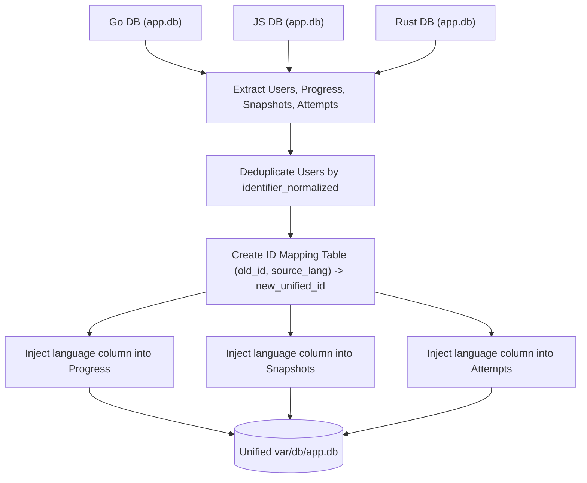

# 04 — Data Model & Migration Strategy

This document specifies the unified SQLite schema for `checkpoints` and the end-to-end data migration procedure to consolidate existing production databases without data loss.

---

## 1. Unified SQLite Schema

The unified database merges the schemas of the three independent projects into a single file at `var/db/app.db`. The `language` column is introduced as a first-class compound key on all progress, snapshot, and attempt records.

```sql
-- PRAGMA configuration applied at connection time:
-- PRAGMA journal_mode = WAL;
-- PRAGMA busy_timeout = 5000;
-- PRAGMA foreign_keys = ON;
-- PRAGMA synchronous = NORMAL;

-- 1. Users Table (Unified across all languages)
CREATE TABLE IF NOT EXISTS users (
  id                     INTEGER PRIMARY KEY AUTOINCREMENT,
  identifier_normalized  TEXT UNIQUE NOT NULL, -- Lowercased Reboot01 username
  reboot_user_id         TEXT UNIQUE,
  claims_json            TEXT,
  preferences_json       TEXT DEFAULT '{}',    -- Editor theme, keybindings, tab size
  starred_slugs_json     TEXT DEFAULT '[]',    -- Bookmarked exercise slugs for quick revision
  created_at             TEXT NOT NULL,
  last_login_at          TEXT
);

-- 2. Sessions Table (Single sign-in for all tracks)
CREATE TABLE IF NOT EXISTS sessions (
  id           TEXT PRIMARY KEY,
  user_id      INTEGER NOT NULL REFERENCES users(id) ON DELETE CASCADE,
  created_at   TEXT NOT NULL,
  expires_at   TEXT NOT NULL,
  revoked_at   TEXT,
  user_agent   TEXT,
  last_seen_at TEXT
);
CREATE INDEX IF NOT EXISTS idx_sessions_user ON sessions(user_id);
CREATE INDEX IF NOT EXISTS idx_sessions_active ON sessions(id, expires_at) WHERE revoked_at IS NULL;

-- 3. Progress Table (Partitioned by user, language, and exercise)
CREATE TABLE IF NOT EXISTS progress (
  user_id       INTEGER NOT NULL REFERENCES users(id) ON DELETE CASCADE,
  language      TEXT NOT NULL CHECK (language IN ('go', 'js', 'rust')),
  exercise_slug TEXT NOT NULL,
  files_json    TEXT NOT NULL,
  status        TEXT NOT NULL DEFAULT 'attempted' CHECK (status IN ('untouched', 'attempted', 'passed')),
  updated_at    TEXT NOT NULL,
  PRIMARY KEY (user_id, language, exercise_slug)
);
CREATE INDEX IF NOT EXISTS idx_progress_status ON progress(user_id, language, status);

-- 4. Snapshots Table (Code versions tagged by language)
CREATE TABLE IF NOT EXISTS snapshots (
  id            INTEGER PRIMARY KEY AUTOINCREMENT,
  user_id       INTEGER NOT NULL REFERENCES users(id) ON DELETE CASCADE,
  language      TEXT NOT NULL CHECK (language IN ('go', 'js', 'rust')),
  exercise_slug TEXT NOT NULL,
  kind          TEXT NOT NULL CHECK (kind IN ('manual', 'passing')),
  files_json    TEXT NOT NULL,
  created_at    TEXT NOT NULL
);
CREATE INDEX IF NOT EXISTS idx_snapshots_lookup ON snapshots(user_id, language, exercise_slug, created_at DESC);
-- Exactly one passing snapshot per exercise per language; manual snapshots can be multiple
CREATE UNIQUE INDEX IF NOT EXISTS idx_snapshots_passing
  ON snapshots(user_id, language, exercise_slug)
  WHERE kind = 'passing';

-- 5. Execution Attempts Table (Consolidated audit history)
CREATE TABLE IF NOT EXISTS attempts (
  id            INTEGER PRIMARY KEY AUTOINCREMENT,
  user_id       INTEGER NOT NULL REFERENCES users(id) ON DELETE CASCADE,
  language      TEXT NOT NULL CHECK (language IN ('go', 'js', 'rust')),
  exercise_slug TEXT NOT NULL,
  checkpoint    TEXT,
  mode          TEXT NOT NULL CHECK (mode IN ('run', 'submit')),
  outcome       TEXT NOT NULL CHECK (outcome IN ('passed', 'failed', 'unformatted', 'forbidden', 'build_error', 'missing_file', 'timeout', 'output_limit', 'oom', 'cancelled', 'error')),
  exit_code     INTEGER,
  duration_ms   INTEGER,
  created_at    TEXT NOT NULL
);
CREATE INDEX IF NOT EXISTS idx_attempts_user_lang ON attempts(user_id, language, created_at DESC);
CREATE INDEX IF NOT EXISTS idx_attempts_history ON attempts(user_id, language, exercise_slug);

-- 6. Mock Exam Sessions Table (Timed exam practice sessions)
CREATE TABLE IF NOT EXISTS mock_sessions (
  id              TEXT PRIMARY KEY,
  user_id         INTEGER NOT NULL REFERENCES users(id) ON DELETE CASCADE,
  language        TEXT NOT NULL CHECK (language IN ('go', 'js', 'rust')),
  checkpoint      TEXT NOT NULL,
  duration_mins   INTEGER NOT NULL,
  started_at      TEXT NOT NULL,
  ended_at        TEXT,
  highest_level   INTEGER NOT NULL DEFAULT 0,
  score           INTEGER NOT NULL DEFAULT 0,
  state_json      TEXT NOT NULL, -- Active level, drawn exercises, elapsed time
  status          TEXT NOT NULL DEFAULT 'active' CHECK (status IN ('active', 'completed', 'abandoned'))
);
CREATE INDEX IF NOT EXISTS idx_mock_user ON mock_sessions(user_id, language, started_at DESC);
```

---

## 2. Legacy Databases Context

The host machine (`appsyss-vm`) currently maintains three production SQLite databases:
1. `go-checkpoints`: `/home/abbas/Documents/go-checkpoints/var/db/app.db`
2. `js-checkpoints`: `/home/abbas/Documents/js-checkpoints/var/db/app.db`
3. `rust-checkpoints`: `/home/abbas/Documents/rust/var/db/app.db`

Each database contains independent student records, historical attempts, and saved progress. Because students use their identical Reboot01 username across all three sites, a user will likely exist in two or three of these databases under different auto-incremented `id` primary keys.

### 2.1 Empirical Cross-Track Audit
* **Exercise Slug Namespace:** Empirical analysis of all exercises currently across the three projects shows:
  * Go: 60 exercises
  * JavaScript: 29 exercises
  * Rust: 40 exercises
  * **Collisions: Exactly 0 overlapping slugs**.
  * Despite zero current collisions, `language` is strictly retained in composite primary keys `(user_id, language, exercise_slug)` to guarantee architectural isolation and cleanly support future curriculum additions.

### 2.2 Schema Divergence Across Legacy Repositories
Before running the migration, the tool must account for existing schema differences:
1. **Rust File Representation:**
   * Go and JS stored code as `files_json TEXT NOT NULL`.
   * Rust stored code as two separate columns: `lib_rs TEXT` and `main_rs TEXT`.
   * *Resolution:* The migration must convert Rust's columns to JSON: `JSON.stringify({ "lib.rs": lib_rs, "main.rs": main_rs })`.
2. **Rust Attempts Schema:**
   * Go and JS stored `mode ('run' | 'submit')` and explicit `outcome`.
   * Rust stored `kind ('run' | 'test')` and did not record `outcome` (only `exit_code`).
   * *Resolution:* Map `kind = 'test'` to `mode = 'submit'`. Set `outcome = (exit_code === 0 ? 'passed' : 'failed')`.
3. **Status Terminology Normalization:**
   * Go used `'untouched'`, `'attempted'`, `'passed'`.
   * JS used `'attempted'`, `'passed'`.
   * Rust used `'in_progress'`, `'passed'`.
   * *Resolution:* Normalize Rust's `'in_progress'` to `'attempted'`. The unified status enum is `('untouched', 'attempted', 'passed')`.

---

## 3. Data Migration Algorithm

A standalone migration utility script (`server/src/db/migrate-old/merge.ts`) shall be executed during deployment to consolidate all three databases into the new unified schema.



### 3.1 Step-by-Step Migration Procedure

#### Step 1: Backup & Isolation
1. Stop all three legacy service processes (`go-checkpoints`, `js-checkpoints`, `rust-checkpoints`).
2. Create timestamped backups of all three `.db` files:
   ```bash
   cp /path/to/go-checkpoints/var/db/app.db /backup/go_app.db.bak
   cp /path/to/js-checkpoints/var/db/app.db /backup/js_app.db.bak
   cp /path/to/rust/var/db/app.db /backup/rust_app.db.bak
   ```

#### Step 2: User Reconciliation
* Query all unique `identifier_normalized` from the three source databases.
* For each user:
  * Select the earliest `created_at` timestamp.
  * Select the most recent `last_login_at` timestamp.
  * Insert a single unified row into `checkpoints/var/db/app.db.users`.
* Maintain an in-memory mapping:
  `map[(source_lang, old_user_id)] => new_unified_user_id`

#### Step 3: Progress & Snapshot Merge
* Iterate through `progress` in each database:
  * Resolve `new_user_id = map[(source_lang, old_user_id)]`.
  * Insert row into unified `progress` with `language = source_lang`.
  * In case of duplicates within the same language, retain the row with the most recent `updated_at`.
* Iterate through `snapshots` in each database:
  * Remap `user_id` and insert with `language = source_lang`.

#### Step 4: Attempt History Merge
* Iterate through `attempts` in each database:
  * Remap `user_id` and insert with `language = source_lang`.

---

## 4. Rollback Plan

If any phase of the migration fails verification:
1. The new unified database file `var/db/app.db` is discarded.
2. The original legacy database files remain untouched and unmodified.
3. Legacy systemd services (`go-checkpoints`, `js-checkpoints`, `rust-checkpoints`) can be immediately restarted with zero data loss or student interruption.

