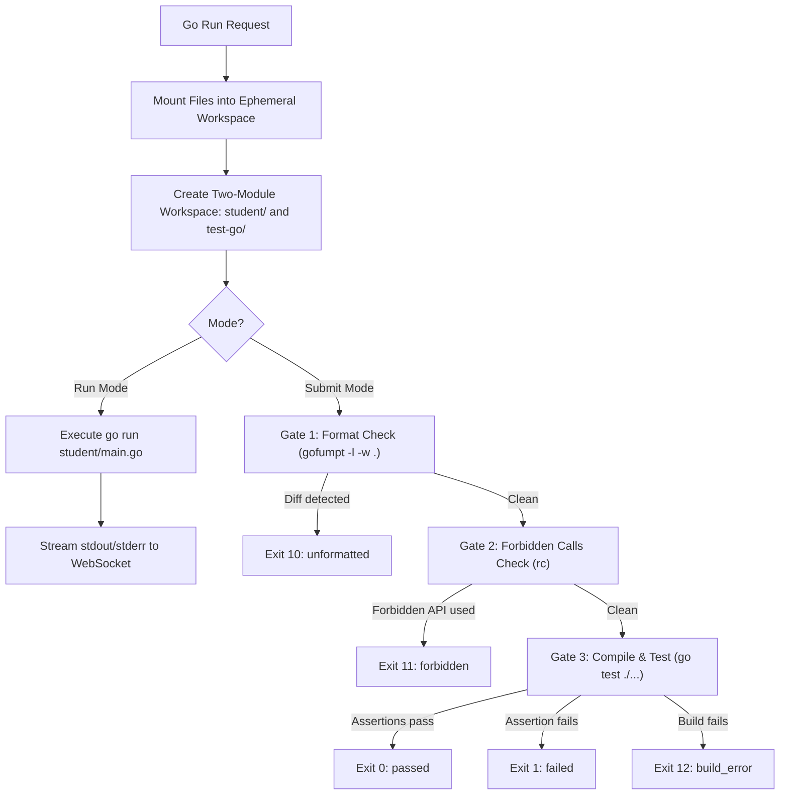
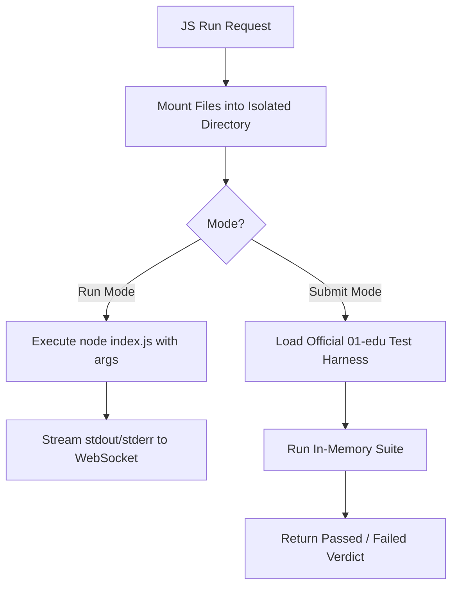
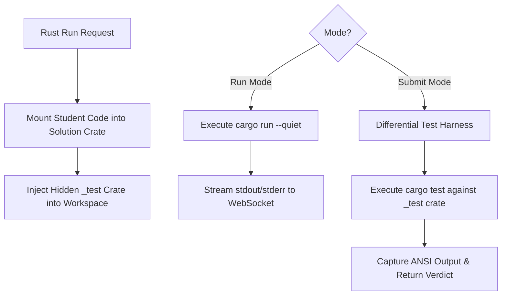

# 05 — Execution Runners Specification

This document details the sandboxed execution engines, language-specific grading pipelines, and dual-backend runner architecture (Local Docker vs Google Cloud Run).

---

## 1. Unified Verdict & Outcome Model

All language runners must map their specific process termination states, compiler warnings, and gate failures into the unified `Outcome` type:

| Exit Code | Outcome | Description | Trigger Pipeline |
|---|---|---|---|
| `0` | `passed` | All assertions passed; code satisfies requirements. | All languages |
| `1` | `failed` | Test assertion failure; wrong output or logic error. | All languages |
| `10` | `unformatted` | Code does not adhere to official formatting standard. | Go (`gofumpt`) |
| `11` | `forbidden` | Code calls disallowed functions or standard library APIs. | Go (`rc` AST check) |
| `12` | `build_error` | Compiler or syntax error; code failed to build. | Go / Rust |
| `13` | `missing_file`| Required submission file (e.g. `main.go`, `lib.rs`) missing. | All languages |
| `-` | `timeout` | Execution exceeded maximum allowed duration. | Backend kill |
| `-` | `output_limit`| Output exceeded maximum buffer cap (1 MB). | Backend kill |
| `-` | `oom` | Container terminated by Linux kernel OOM killer. | Backend / Docker inspect |
| `-` | `cancelled` | Execution explicitly stopped by user or client disconnect. | Backend kill |
| `-` | `error` | Internal system error or container setup failure. | Backend |

---

## 2. Go Execution Pipeline



### 2.1 Two-Module Workspace Contract
* The student submission is mounted into `piscine-go/` as module `student`.
* The official test harness is mounted as module `test-go/`.
* `test-go/go.mod` specifies:
  `replace student => ../piscine-go`
* The test harness imports functions directly from `student` and executes official test cases.

### 2.2 Go Toolchain Pinning
* **Compiler:** `go1.25.12` with `GOTOOLCHAIN=local`.
* Exact compiler version parity is mandatory to guarantee identical compiler error formatting.

---

## 3. JavaScript Execution Pipeline



### 3.1 JavaScript Sandboxing
* JS submissions run within an isolated Node.js container with:
  * No access to the host filesystem.
  * No outbound network capability (`--network none`).
  * Strict memory quota (256 MB).
  * Strict execution timeout (30 seconds).

---

## 4. Rust Execution Pipeline



### 4.1 Hidden Test Injection
* The `_test` crate is kept strictly on the host and injected into the container at mount time.
* The test harness runs differential assertions comparing student function outputs against the pre-compiled reference solution.
* Cargo dependencies are pre-compiled and baked into the runner image to avoid long compile times during practice runs.

---

## 5. Dual Backend Architecture: Local Docker vs Cloud Run

The platform supports two swappable execution backends via the `RUNNER_BACKEND` environment variable:

```
RUNNER_BACKEND=docker     # Executes locally on appsyss-vm via dockerode
RUNNER_BACKEND=cloudrun   # Delegates execution to serverless Google Cloud Run
```

### 5.1 Local Docker Backend (`docker`)
* **Mechanism:** Uses the `dockerode` library connected to local `/var/run/docker.sock`.
* **Pros:** Zero financial running cost; all data stays on the local VM.
* **Constraints:** Must strictly observe the local concurrency ceiling (max 2 active containers) and memory limits (256 MB each).

### 5.2 Serverless Cloud Run Backend (`cloudrun`)
* **Mechanism:** Dispatches the grading payload over HTTPS to private Google Cloud Run container instances.
* **Performance:** Eliminates local CPU/RAM pressure on `appsyss-vm`. Median execution drops from ~3500ms to ~550ms.
* **Security:** Egress-quarantined serverless containers with automated scaling and zero local host socket interaction.
* **Interchangeability:** Cloud Run returns identical exit codes and streaming logs as the local Docker runner, ensuring complete transparency for the student.

