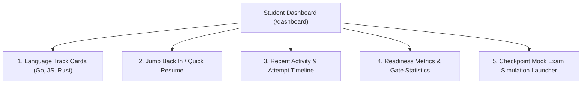
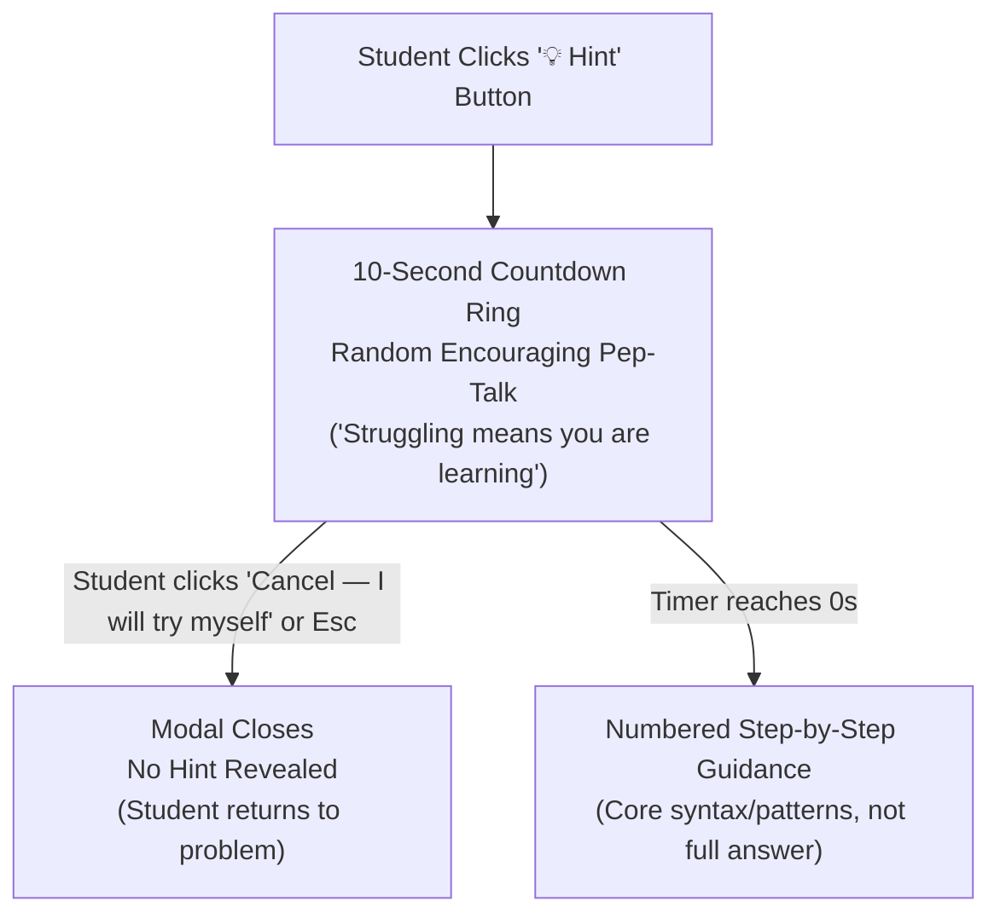
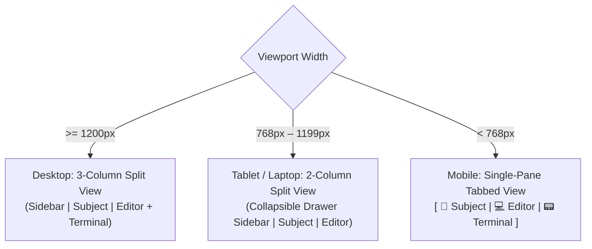

# 07 — Dashboard, Account History & Advanced Features

This document specifies user-facing features beyond the core editor workbench: the central student dashboard, detailed submission history, solutions archive, mock checkpoint exam simulation, and personal account preferences.

---

## 1. Central Student Dashboard

When a student signs in, they land on a comprehensive overview dashboard (`https://checkpoints.appsyss.com/dashboard`) before drilling down into specific exercises.



### 1.1 Multi-Track Mastery Cards
The dashboard displays three prominent progress cards—one for **Go**, **JavaScript**, and **Rust**:
* **Completion Progress:** Visual percentage bar and count of passed exercises (e.g., `45 / 60 passed (75%)`).
* **Level Progression:** Highest unlocked checkpoint level (e.g., `Checkpoint 03 · Level 02`).
* **Quick Resume Button:** Direct CTA button that opens the most recently edited exercise in that track with the student's unsaved code restored.

### 1.2 Recent Activity Timeline
* A real-time chronological log of the student's last 10 submission/run attempts across all tracks.
* Each entry displays:
  * Timestamp (e.g., *12 minutes ago*).
  * Language badge (`Go`, `JS`, `Rust`).
  * Exercise title and level.
  * Outcome badge (`Passed` in green, `Failed` in red, `Unformatted` in yellow, `Forbidden` in purple).
  * One-click navigation to reopen that exercise.

### 1.3 Readiness Radar & Gate Warning Analytics
* **Exam Readiness Score:** An aggregated readiness rating calculating whether the student has completed all mandatory level exercises for each checkpoint.
* **Pre-Test Gate Health:**
  * For Go: Tracks how often the student encounters `gofumpt` formatting rejections or `rc` forbidden function violations, alerting them to bad habits before exam day.

---

## 2. Submission History & Results Explorer

Accessible via `/history`, this dedicated view provides a searchable, filterable audit log of every execution attempt the student has ever made.

### 2.1 Filter & Search Capabilities
Students can slice their history by:
* **Language Track:** `All`, `Go`, `JavaScript`, `Rust`.
* **Action Mode:** `Submit` (official grading) vs `Run` (manual test).
* **Outcome:** `Passed`, `Failed`, `Unformatted`, `Forbidden`, `Build Error`, `Timeout`, `OOM`.
* **Date Range / Checkpoint Level**.
* **Exercise Search:** Filter by slug or title.

### 2.2 Attempt Detail Inspector
Clicking on any historical attempt opens an inspection modal displaying:
* **Execution Summary:** Duration in milliseconds, numeric exit code, exact timestamp.
* **Captured Terminal Output:** The exact compiler errors, linter output, or assertion diff generated during that run.
* **Submitted Code View:** Read-only view of the code files executed in that attempt.

---

## 3. Passing Solutions Vault & ZIP Export

### 3.1 Personal Solutions Library (`/solutions`)
* Students who pass an exercise automatically generate a `passing` snapshot.
* The Solutions Vault organizes all passing solutions into a clean library by language track and checkpoint level.
* Features:
  * Syntax-highlighted read-only preview.
  * One-click "Copy Code to Clipboard".
  * "Load into Workbench" (to use as a baseline for experimentation).

### 3.2 Bulk Solution Export (`.zip`)
* Students can download their entire portfolio of passing solutions as a structured `.zip` archive:
  ```
  reboot01-solutions-<username>/
  ├── go/
  │   ├── printnbr/main.go
  │   └── strlen/strlen.go
  ├── js/
  │   └── elementary/elementary.js
  └── rust/
      └── groceries/src/lib.rs
  ```
* Allows students to preserve, study, or archive their solutions offline before exam day.

---

## 4. Checkpoint Mock Exam Simulation Mode (`/mock`)

In the official Reboot01 curriculum, checkpoints are timed, high-pressure exams. The tester provides a **Simulation Mode** that mimics exam conditions.

### 4.1 Mock Exam Workflow
1. **Initial Start Popup & Configuration:**
   * Clicking **"🎯 Exam Mode"** opens an initial setup modal where students configure their exam:
     * **Track Selection:** Choose language (`Go`, `JavaScript`, or `Rust`).
     * **Checkpoint Selection:** Select target checkpoint (e.g. `Go Checkpoint 02`). The modal shows the total question count, which is **strictly one question per level** (e.g., a checkpoint with 4 levels = exactly 4 questions).
     * **Configurable Exam Duration:** Set the exam countdown timer. The official default is **3 hours (180 minutes)**. Students can adjust the timer (presets: `1 hour`, `2 hours`, `3 hours (Default)`, custom duration, or `Untimed Practice`).
2. **Sequential One-Per-Level Progression:**
   * **Exact Question Allocation:** An exam contains **only one randomly drawn question from each level** of the selected checkpoint (e.g. Level 00 $\rightarrow$ Level 01 $\rightarrow$ Level 02...).
   * **Sequential Unlocking:** The exam starts on Level 00. Passing Level 00 with `Submit` records the pass and automatically unlocks and loads the randomly drawn question for Level 01.
   * **Blind Progression:** Future level question names remain hidden (displayed as `?`) until the student advances to that level.
   * **Optional Reroll / Skip:** If a student gets completely stuck, a limited "Reroll / Next Exercise" option can be used (with platform-matching score penalty or recorded in the diagnostic report).
3. **Practice Code Isolation & Pristine Starting Stubs:**
   * When an exam begins, all existing code drafts for drawn exercises are safely set aside and stashed in session storage.
   * Every exam exercise opens with its **unsolved starting stub** (`todo!()` in Rust, pristine starter signatures in Go and JS)—ensuring students cannot bypass an exam question with code previously written during practice.
   * When the exam ends (or if exited early), practice drafts are seamlessly restored to the workbench exactly as the student left them.
4. **Exam HUD:**
   * A persistent top bar displaying remaining exam time, current level, and accumulated score.
   * The normal exercise sidebar is hidden during the exam (since other exercises cannot be opened) and replaced by an in-bar level progression stepper.
   * The **💡 Hint** button and free exercise navigation are strictly disabled during an active exam.
5. **Post-Exam Diagnostic Report:**
   * At the end of the timer or when the student finishes:
     * Overall score and highest level reached.
     * Time spent per exercise.
     * Summary of gate rejections (formatting/forbidden functions).
     * Actionable recommendations on which levels require more practice.

---

## 5. Exercise Catalogue Search & Discovery

Within the main workbench sidebar:
* **Instant Filter Bar:** Instant fuzzy search by exercise slug, function name, or keyword.
* **Filter by Status:**
  * `All`
  * `Unsolved Only` (hides passed exercises)
  * `Passed Only`
  * `Attempted / In Progress`
* **Filter by Category / Tags:** Tags such as `strings`, `math`, `recursion`, `pointers`, `data-structures`, `arrays`, `bitwise`.

### 5.1 Compact Sidebar Rail with Exercise Dots
To preserve horizontal space on laptops and smaller desktop displays:
* An arrow toggle button at the top of the sidebar collapses the tree into an ultra-narrow rail (~48px width).
* In compact mode:
  * Checkpoint headers abbreviate (e.g. `Checkpoint 01` $\rightarrow$ `CP 01`).
  * Level headers abbreviate (e.g. `Level 1` $\rightarrow$ `L 1`).
  * Exercises render as compact vertical dots with status coloring:
    * **Green dot:** passed.
    * **Blue dot with glowing ring:** currently active exercise open in editor.
    * **Muted grey dot:** unpassed / untouched.
  * Hovering (on desktop) or tapping/long-pressing (on touch devices) an exercise dot reveals an anchored name bubble to the right without forcing the sidebar to unfold.
* The collapsed/expanded state is persisted in `localStorage`.

---

## 6. Pedagogical Hint System with Friction (10-Second Countdown)

To assist students when genuinely stuck without short-circuiting the critical learning struggle:



### 6.1 Intentional Friction Workflow
1. **The 💡 Hint Action:** Located in the workbench toolbar above the editor (hidden during active Mock Exams).
2. **Delayed Countdown & Pep-Talk:**
   * Clicking the button opens a modal displaying an animated **10-second countdown ring**.
   * A rotating message of encouragement is displayed (e.g., *"Struggling means you are learning"*, *"Try it your way first"*, *"You've got this"*).
   * A prominent **"Cancel — I'll try myself"** button allows the student to back out before any hint is displayed.
3. **Structured Step-by-Step Hints:**
   * Once the countdown completes, numbered guidance steps are revealed (Step 1, Step 2, Step 3).
   * Hints focus on algorithmic direction, edge-case traps (e.g. trailing newlines, zero inputs), and suggested standard library tools (e.g. `.chars()`, `strings.Split`, `reduce`), without giving away the full solution code.
4. **General Fallback:** Exercises lacking custom hints fall back to structured general problem-solving heuristics.

---

## 7. Personalization & Editor Preferences

To provide an optimal coding experience, student preferences are persisted both in browser storage and optionally synchronized to the user account:

### 7.1 Editor Settings
* **Keybinding Emulation:**
  * Standard (default Monaco)
  * Vim Mode
  * Emacs Mode
* **Indentation Rules:**
  * Configurable tab size: 2 spaces, 4 spaces, or hard tabs (with Go automatically enforcing hard tabs per `gofmt` specifications).
* **Editor Theme:**
  * VS Code Dark+ (default)
  * GitHub Dark
  * High Contrast Dark
* **Auto-Format on Save:**
  * When enabled, pressing `Ctrl+S` / `Cmd+S` automatically formats code (`gofumpt` for Go, Prettier for JS, `rustfmt` for Rust).

---

## 8. Responsive Layout & Mobile/Tablet Adaptation

While desktop workstations remain the primary target for coding, students frequently review subjects, check submission histories, and inspect solutions from laptops, tablets, and mobile devices. The unified platform transitions from the legacy rigid 3-column desktop layout to an adaptive multi-breakpoint system.



### 8.1 Breakpoint Behaviors
1. **Desktop (`>= 1200px`):**
   * Full 3-column workbench with draggable, keyboard-accessible `Split` dividers.
   * Pane widths persist in `localStorage`.
2. **Tablet & Small Laptops (`768px – 1199px`):**
   * The exercise tree collapses into a slide-over drawer triggered by a hamburger button or `Ctrl+B`.
   * Subject and Editor share the main viewport in a 2-column split with vertical splitter.
   * Output terminal docks under the editor with a draggable horizontal splitter.
3. **Mobile (`< 768px`):**
   * Single-pane view with a persistent top segmented control:
     `[ 📖 Subject | 💻 Editor | 📟 Output ]`
   * Persistent sticky bottom action bar containing:
     * Status icon / previous verdict badge.
     * `Run` and `Submit` buttons with touch-friendly hit areas (`min 44px`).
     * Cooldown countdown timer.

### 8.2 Mobile Output Experience: Plain-Text Terminal (`PlainTerminal`)
On desktop, `xterm.js` renders terminal output to a `<canvas>` element. However, on mobile touchscreens, `xterm.js` has severe drawbacks: its hidden input `<textarea>` steals keyboard focus, summons the software keyboard inappropriately, and breaks native touch selection.
* **Touch Device Adaptation:** On mobile devices, the platform dynamically swaps `xterm.js` for an accessible, lightweight **Plain-Text Terminal** component.
* **ANSI Color Parser:** Parses standard ANSI SGR escape sequences into clean HTML `<span>` elements with theme colors (red for assertion failures, green for passes, yellow for warnings).
* **Native Selection & Copy:** Allows students to naturally long-press, highlight, and copy compiler error messages using standard mobile OS selection handles.
* **Text Wrapping:** Automatically wraps long compiler lines to prevent awkward horizontal panning on small phone screens.

### 8.3 Mobile Touch Ergonomics: Symbol Bar & Undo/Redo
* **Dedicated Mobile Symbol Row:** Coding in Go, JavaScript, and Rust requires frequent use of brackets, braces, and operators that are buried on second/third pages of mobile keyboards. A slim, non-intrusive programming symbol bar floats above the keyboard providing one-tap access to:
  `( ) { } [ ] ; : . , = & ! " _ -> ::` and cursor navigation arrows.
* **Mobile Undo (↶) & Redo (↷):** Mobile touchscreens lack `Ctrl+Z` / `Ctrl+Y`. Dedicated Undo and Redo icon buttons are pinned directly in the mobile editor header bar to easily recover from accidental keystrokes.

---

## 9. Global Keyboard Shortcuts & Command Palette

To provide a seamless developer experience, the platform implements comprehensive global keyboard navigation.

### 9.1 Command Palette (`Ctrl+K` / `Cmd+K`)
Pressing `Ctrl+K` or `Cmd+K` opens a modal command palette with instant fuzzy search:
* **Jump to Exercise:** Search any exercise by name, slug, or keyword across Go, JavaScript, and Rust (e.g., typing `strlen` or `gcd` jumps directly to that exercise).
* **Track Switching:** Quickly switch between `Go`, `JavaScript`, and `Rust`.
* **Actions:** "Format Code", "Reset Starter Stub", "Toggle Zen Mode", "Export All Solutions", "Start Mock Exam".

### 9.2 Keyboard Shortcut Matrix

| Shortcut (Mac / Linux & Win) | Action | Scope |
|---|---|---|
| `Cmd+Enter` / `Ctrl+Enter` | **Run Code** (test run with demo/arguments) | Global / Editor |
| `Cmd+Shift+Enter` / `Ctrl+Shift+Enter` | **Submit Code** (official grading) | Global / Editor |
| `Cmd+S` / `Ctrl+S` | **Save & Auto-Format** (triggers formatter if enabled) | Editor |
| `Cmd+B` / `Ctrl+B` | **Toggle Exercise Sidebar** (show/hide tree) | Global |
| `Cmd+J` / `Ctrl+\`` | **Toggle Terminal Height** (collapse / expand terminal) | Global |
| `Cmd+Shift+F` / `Ctrl+Shift+F` | **Toggle Focus / Zen Mode** (maximizes editor) | Global |
| `Alt+Right` / `Alt+Left` | **Next / Previous Exercise** in current level | Global |
| `?` | **Open Keyboard Shortcuts Cheatsheet** | Global (when not editing) |
| `Escape` | Close dialogs, dismiss menus, or exit Zen Mode | Global |

---

## 10. Interactive Assertion & Diff Viewer

When a test fails during official grading (`outcome = 'failed'`), students often struggle to identify subtle character, spacing, or newline mismatches in raw terminal stdout. The platform introduces a structured **Assertion Diff Card** rendered immediately above the terminal.

```
┌────────────────────────────────────────────────────────────────────────┐
│ ❌ Assertion Failed: Gcd(42, 10)                                       │
│                                                                        │
│ Expected: 2                                                            │
│ Actual:   3                                                            │
│                                                                        │
│ [📋 Copy input arguments into Run box]   [🔍 View raw terminal output] │
└────────────────────────────────────────────────────────────────────────┘
```

### 10.1 Features
* **Visual Output Diff:** Highlighting character-by-character discrepancies (missing trailing newline, extra spaces, off-by-one results).
* **One-Click Debug Injection:** Clicking **"Copy to Run box"** automatically populates the `args` input box with the exact failing test inputs so the student can press `Run` to step through the failure locally.
* **Toggable Raw Output:** Students can switch between the structured diff card and raw `xterm.js` ANSI output at any time.

---

## 11. Focus Mode (Zen Mode) & Workspace Customization

### 11.1 Zen Mode
For long coding sessions, students can enter **Focus / Zen Mode** (`Ctrl+Shift+F`):
* Collapses the sidebar and subject panels entirely.
* Monaco editor expands to fill 100% of the screen.
* A floating, translucent mini-HUD provides:
  * Exercise title and breadcrumb.
  * `Run`, `Submit`, and `Cancel` buttons.
  * A button to pop out the subject in a floating drawer.
* Pressing `Escape` or clicking the exit button returns to the standard 3-column layout.

### 11.2 Editor Font & Visual Controls
Accessible via the editor toolbar or preferences:
* **Font Size Adjuster:** Dynamic font resizing (`12px` to `22px`) with quick `A-` / `A+` buttons or `Ctrl+Wheel`.
* **Font Family Selection:** `JetBrains Mono`, `Fira Code`, or system monospace font.
* **Line Wrapping:** Toggle between `soft wrap` (wrap long lines) and `no wrap` (horizontal scrolling).
* **High-Contrast Theme:** WCAG AAA high-contrast dark theme option for enhanced accessibility.

---

## 12. Streamlined Exercise Progression & Bookmarking

### 12.1 Post-Pass Progression Prompt
* When a submission passes (`outcome = 'passed'`), a non-intrusive bottom banner appears:
  ```
  🎉 Exercise Passed!  [ Continue to Next Exercise (Enter) → ]
  ```
* Pressing `Enter` or clicking the banner smoothly loads the next exercise in that level without requiring manual tree navigation.

### 12.2 Exercise Star / Bookmark System
* Students can click a **Star (⭐)** icon on any exercise.
* The sidebar includes a filter tab: `All` | `Unsolved` | `Passed` | `⭐ Starred`.
* Allows students to mark tricky or exam-critical problems (e.g. `fprime`, `rostring`, `hiddenp`) to revisit right before checkpoint day.

### 12.3 Interactive Breadcrumbs
The workbench header displays a clickable breadcrumb:
`[Go] Piscine Go > Checkpoint 02 > Level 01 > strlen`
* Clicking any segment opens a dropdown allowing instant level-jumping.

---

## 13. Loading Skeletons & Network Resiliency

### 13.1 Skeleton Placeholders
* Replaces static "Loading…" text with animated, content-aware skeleton placeholders during initial bootstrap and exercise transitions:
  * Tree skeleton with animated pulsing bars.
  * Subject skeleton with heading and paragraph blocks.
  * Editor skeleton matching Monaco line heights.

### 13.2 Offline & Network Interruption Handling
* **Offline Detection:** If the student's internet drops while working, an amber status pill appears:
  `⚠ Offline — changes safely saved in local storage`.
* **Automatic Re-sync:** On reconnection, the platform automatically syncs unsaved drafts to the server and displays a success toast:
  `Synced 1 saved draft with server`.
* **Screen Reader Live Announcements:** Terminal verdicts (`Passed`, `Tests failed`, `Timed out`) and queue status changes are bound to `aria-live="polite"` regions so assistive technology immediately announces grading outcomes.

---

## 14. About & Community Acknowledgements Modal

Accessible from the global navigation and workbench overflow menu (`⋯`), the **About** modal provides transparency regarding the platform's independent educational status, authorship, and community contributions.

### 14.1 Content Structure
* **Project Purpose:** Free, voluntary browser-based practice environment for Reboot01 students across Go, JavaScript, and Rust.
* **Non-Affiliation Disclaimer:** Explicit statement that the platform is built independently by students and is not affiliated with Reboot or 01-edu.
* **Lead Developer:** Built and maintained by **Abbas Hasan** (`@abbhasan`).
* **Community Acknowledgements & Special Thanks:**
  * Prominently recognizes and thanks **Ali Alsaroo** (`aalsaroo`):
    * Credited for key frontend design suggestions, mobile touch ergonomics (programming symbol row, mobile text selection layer, plain-text terminal adaptation), the 10-second friction hint system design, and mock exam simulation testing.

---

## 15. Schema Additions for User Features

To support user preferences, starred bookmarks, and mock exam sessions, minimal backward-compatible additions are made to the database schema:

```sql
-- Add preferences and starred exercises to users table
ALTER TABLE users ADD COLUMN preferences_json TEXT DEFAULT '{}';
ALTER TABLE users ADD COLUMN starred_slugs_json TEXT DEFAULT '[]';

-- Table for Mock Exam Sessions
CREATE TABLE IF NOT EXISTS mock_sessions (
  id              TEXT PRIMARY KEY,
  user_id         INTEGER NOT NULL REFERENCES users(id) ON DELETE CASCADE,
  language        TEXT NOT NULL CHECK (language IN ('go', 'js', 'rust')),
  checkpoint      TEXT NOT NULL,
  duration_mins   INTEGER NOT NULL,
  started_at      TEXT NOT NULL,
  ended_at        TEXT,
  highest_level   INTEGER NOT NULL DEFAULT 0,
  score           INTEGER NOT NULL DEFAULT 0,
  state_json      TEXT NOT NULL, -- Active level, drawn exercises, elapsed time
  status          TEXT NOT NULL DEFAULT 'active' CHECK (status IN ('active', 'completed', 'abandoned'))
);
CREATE INDEX IF NOT EXISTS idx_mock_user ON mock_sessions(user_id, language, started_at DESC);
```

