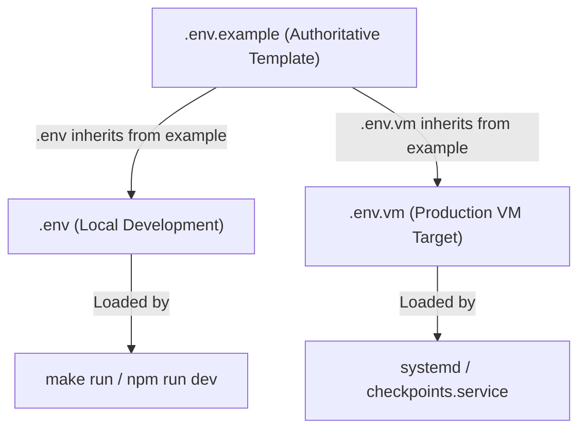

# 01 — Monorepo & Scaffolding Design

This document details the monorepo structure, workspace package management, configuration hierarchy, operational tooling, and developer workflows for the unified `checkpoints` platform.

---

## 1. Monorepo Directory Organization

The repository is structured as a two-package npm workspace (`server` and `web`) flanked by shared operational scripts, canonical content trees, and runner contexts:

```
checkpoints/
├── docs/                     # Specifications and architectural documentation
│   ├── 00_requirements/     # Formal system requirements suite
│   └── 01_design/           # Engineering design and implementation specifications
├── content/                  # Read-only canonical exercise contents & tests
│   ├── go/                   # 60 Go exercises, sources, and index.json
│   ├── js/                   # 29 JS exercises, sources, and index.json
│   └── rust/                 # 40 Rust exercises, test crates, and index.json
├── runner/                   # Docker build contexts & grading assets
│   ├── go/                   # Dockerfile, entrypoint.sh, rc tool, gofumpt
│   ├── js/                   # Dockerfile, sandbox image, test runner
│   └── rust/                 # Dockerfile, pre-cached cargo dependencies
├── server/                   # Unified Node.js / Express backend workspace
│   ├── package.json
│   ├── tsconfig.json
│   ├── dist/                 # Compiled JavaScript output
│   └── src/                  # TypeScript source tree
├── web/                      # Unified React 18 / Vite frontend workspace
│   ├── package.json
│   ├── tsconfig.json
│   ├── vite.config.ts
│   ├── dist/                 # Built client SPA assets
│   └── src/                  # React source tree
├── scripts/                  # Operational, build, and deployment automation
│   ├── lib/
│   │   └── common.sh         # Shared bash library (logging, traps, port checks)
│   ├── build.sh              # Orchestrates server & web builds
│   ├── test.sh               # Runs full verification suite across all tracks
│   └── vm-deploy.sh          # Deployment script to appsyss-vm
├── var/                      # Ephemeral local runtime data (git-ignored)
│   ├── db/                   # SQLite database (app.db, app.db-wal, app.db-shm)
│   ├── logs/                 # Service logs (backend.log, frontend.log)
│   └── run/                  # Process PID files
├── .env                      # Local development configuration (git-ignored)
├── .env.example              # Documented configuration template
├── .env.vm                   # Production VM configuration (git-ignored; backed up to PrivateBox — decisions D1)
├── Makefile                  # Root developer CLI & automation orchestrator
├── package.json              # Root npm workspaces manifest
└── README.md                 # Public documentation and quick links
```

---

## 2. Root Workspace Manifest (`package.json`)

The root `package.json` configures npm workspaces, delegating dependencies to `server` and `web` while maintaining a single, deduplicated `package-lock.json`:

```json
{
  "name": "checkpoints",
  "version": "0.1.0",
  "private": true,
  "description": "Unified browser-based checkpoint tester for Reboot01 students (Go, JS, Rust)",
  "workspaces": [
    "server",
    "web"
  ],
  "engines": {
    "node": ">=20"
  },
  "scripts": {
    "build": "npm run build --workspace server && npm run build --workspace web",
    "test": "npm run test --workspace server && npm run test --workspace web",
    "lint": "npm run lint --workspace server && npm run lint --workspace web",
    "clean": "rm -rf server/dist web/dist var/run/*"
  }
}
```

---

## 3. Configuration Hierarchy

System configuration follows a strict three-file hierarchy:



### 3.1 Environment Variable Contract

| Variable | Default (Local) | Production (`.env.vm`) | Role |
|---|---|---|---|
| `NODE_ENV` | `development` | `production` | Node runtime profile |
| `API_PORT` | `8157` | `8157` | Express & WebSocket listen port |
| `WEB_PORT` | `5203` | — | Vite dev server listen port |
| `APP_BASE_URL` | `http://localhost:5203`| `https://checkpoints.appsyss.com` | Canonical public origin |
| `DB_PATH` | `var/db/app.db` | `/home/abbas/Documents/checkpoints/var/db/app.db` | SQLite database file |
| `CONTENT_DIR`| `content` | `/home/abbas/Documents/checkpoints/content` | Exercise catalogue root |
| `RUNNER_BACKEND` | `docker` | `docker` (or `cloudrun`) | Sandbox engine |
| `RUNNER_CONCURRENCY`| `2` | `2` | Global max concurrent containers |
| `COOLDOWN_RUN_SEC` | `5` | `5` | Anti-spam cooldown for Run (seconds) |
| `COOLDOWN_SUBMIT_SEC`| `10` | `10` | Anti-spam cooldown for Submit (seconds) |
| `SESSION_SECRET`| *(random 32B)* | *(random 32B)* | Session signing secret |
| `REBOOT01_SIGNIN_URL`| `https://learn.reboot01.com/api/auth/signin` | `https://learn.reboot01.com/api/auth/signin` | Upstream auth endpoint |

### 3.2 Configuration Loader (`server/src/config/index.ts`)
The backend uses a typed configuration loader that fails fast on startup if required variables are missing or invalid:

```typescript
import dotenv from 'dotenv';
import path from 'node:path';

dotenv.config({ path: process.env.DOTENV_CONFIG_PATH || '.env' });

function required(name: string): string {
  const v = process.env[name];
  if (!v) throw new Error(`Configuration error: missing required environment variable ${name}`);
  return v;
}

function num(name: string, fallback: number): number {
  const v = process.env[name];
  return v ? parseInt(v, 10) : fallback;
}

export const config = {
  env: process.env.NODE_ENV || 'development',
  apiPort: num('API_PORT', 8157),
  webPort: num('WEB_PORT', 5203),
  appBaseUrl: process.env.APP_BASE_URL || 'http://localhost:5203',
  dbPath: path.resolve(process.env.DB_PATH || 'var/db/app.db'),
  contentDir: path.resolve(process.env.CONTENT_DIR || 'content'),
  runner: {
    backend: (process.env.RUNNER_BACKEND || 'docker') as 'docker' | 'cloudrun',
    maxConcurrent: num('RUNNER_CONCURRENCY', 2),
    cooldownSeconds: {
      run: num('COOLDOWN_RUN_SEC', 5),
      submit: num('COOLDOWN_SUBMIT_SEC', 10),
    },
  },
  auth: {
    signinUrl: process.env.REBOOT01_SIGNIN_URL || 'https://learn.reboot01.com/api/auth/signin',
    cookieName: 'cp_session',
    sessionTtlDays: 14,
  },
} as const;
```

---

## 4. Root Makefile Orchestration

The root `Makefile` serves as the uniform CLI interface for both local developers and deployment hooks:

```makefile
.DEFAULT_GOAL := help
SHELL := /bin/bash
.ONESHELL:

# Read port configuration from .env if present
include .env
export

.PHONY: help setup build run kill test clean deploy

help: ## Show this help message
	@grep -E '^[a-zA-Z_-]+:.*?## .*$$' $(MAKEFILE_LIST) | awk 'BEGIN {FS = ":.*?## "}; {printf "\033[36m%-16s\033[0m %s\n", $$1, $$2}'

setup: ## Install dependencies, create var/ layout, verify Docker socket
	@mkdir -p var/db var/logs var/run
	@npm ci
	@if [ ! -S /var/run/docker.sock ]; then \
		echo "Warning: /var/run/docker.sock not found. Ensure Docker daemon is running."; \
	fi
	@echo "Setup complete. Ready to run."

build: ## Compile both server and web workspaces
	@npm run build

run: ## Start backend and frontend detached in local development mode
	@./scripts/build.sh
	@echo "Starting backend (port $(API_PORT)) and web dev server (port $(WEB_PORT))..."
	@mkdir -p var/run var/logs
	@npm run dev --workspace server > var/logs/backend.log 2>&1 & echo $$! > var/run/backend.pid
	@npm run dev --workspace web > var/logs/frontend.log 2>&1 & echo $$! > var/run/frontend.pid
	@echo "Platform online:"
	@echo "  Web UI:  http://localhost:$(WEB_PORT)"
	@echo "  API:     http://localhost:$(API_PORT)"

kill: ## Stop detached development processes
	@if [ -f var/run/backend.pid ]; then kill $$(cat var/run/backend.pid) 2>/dev/null || true; rm -f var/run/backend.pid; fi
	@if [ -f var/run/frontend.pid ]; then kill $$(cat var/run/frontend.pid) 2>/dev/null || true; rm -f var/run/frontend.pid; fi
	@echo "Processes stopped."

test: ## Run verification test suites across workspaces
	@npm run test

clean: ## Remove build artifacts and temporary run logs
	@rm -rf server/dist web/dist var/logs/* var/run/*
	@echo "Cleaned build artifacts."

deploy: ## Deploy platform to production VM (appsyss-vm)
	@./scripts/vm-deploy.sh
```

---

## 5. Shared Shell Tooling (`scripts/lib/common.sh`)

All bash scripts import a common utility library ensuring consistent logging, strict error traps, and safe signal handling:

```bash
#!/usr/bin/env bash
# scripts/lib/common.sh - Shared shell utilities
set -euo pipefail

# ANSI color formatting
RED='\033[0;31m'
GREEN='\033[0;32m'
YELLOW='\033[1;33m'
BLUE='\033[0;34m'
NC='\033[0m' # No Color

log_info()  { echo -e "${BLUE}[INFO]${NC}  $*"; }
log_ok()    { echo -e "${GREEN}[OK]${NC}    $*"; }
log_warn()  { echo -e "${YELLOW}[WARN]${NC}  $*" >&2; }
log_error() { echo -e "${RED}[ERROR]${NC} $*" >&2; }

assert_port_free() {
  local port="$1"
  if ss -ltn "( sport = :$port )" | grep -q "$port"; then
    log_error "Port $port is already bound on host."
    exit 1
  fi
}

assert_command() {
  local cmd="$1"
  if ! command -v "$cmd" &>/dev/null; then
    log_error "Required tool '$cmd' is not installed in PATH."
    exit 1
  fi
}
```

