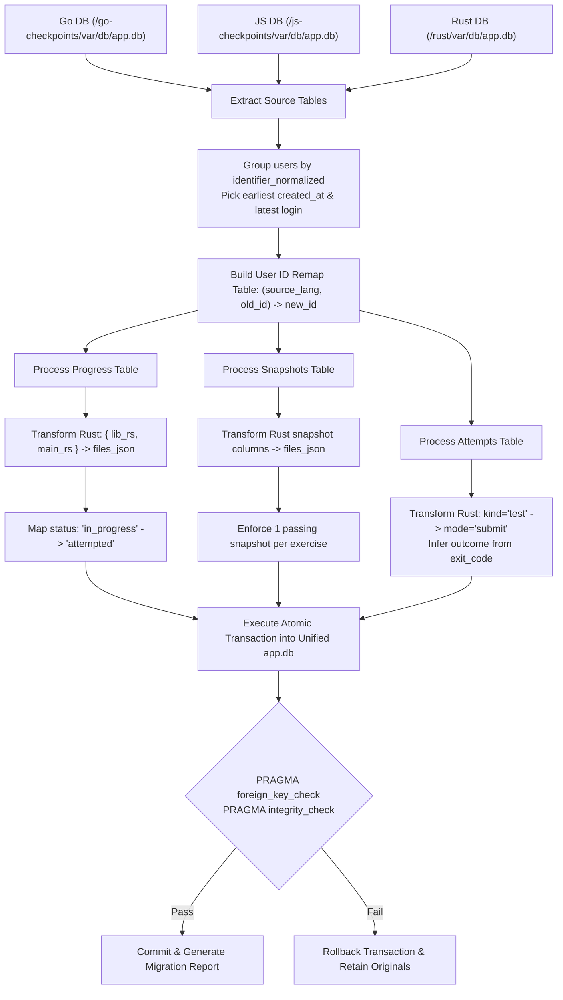

# 02 — Database & Migration Design

This document details the SQLite storage engine configuration, the production database schema DDL, repository layer interfaces, and the automated ETL migration script for consolidating the three legacy databases.

---

## 1. Storage Engine Architecture & Pragmas

The platform stores all state in a single SQLite database file at `var/db/app.db` using Node.js's native `better-sqlite3` driver. To ensure high concurrency, zero deadlocks, and minimal memory usage on the 1.9 GB host VM, connections initialize with mandatory PRAGMA directives:

```typescript
import Database from 'better-sqlite3';
import { config } from '../config/index.js';

export function openDatabase(dbPath = config.dbPath): Database.Database {
  const db = new Database(dbPath);

  // Write-Ahead Logging allows readers and writers to operate concurrently without blocking
  db.pragma('journal_mode = WAL');

  // Wait up to 5000ms if another operation holds the lock before throwing SQLITE_BUSY
  db.pragma('busy_timeout = 5000');

  // Enforce foreign key constraints and cascade deletes
  db.pragma('foreign_keys = ON');

  // NORMAL synchronicity provides safe durability under WAL while avoiding frequent disk syncs
  db.pragma('synchronous = NORMAL');

  // Bound SQLite memory cache to ~4MB (negative value indicates KiB)
  db.pragma('cache_size = -4000');

  return db;
}
```

---

## 2. Complete Schema Specification (DDL)

```sql
-- 1. Users Table (Shared identity across all tracks)
CREATE TABLE IF NOT EXISTS users (
  id                     INTEGER PRIMARY KEY AUTOINCREMENT,
  identifier_normalized  TEXT UNIQUE NOT NULL, -- Lowercased, whitespace-trimmed Reboot01 username
  reboot_user_id         TEXT UNIQUE,          -- Optional upstream claim
  claims_json            TEXT,                 -- Upstream JWT claims payload (diagnostic only)
  preferences_json       TEXT DEFAULT '{}',    -- Editor theme, keybindings, tab size
  starred_slugs_json     TEXT DEFAULT '[]',    -- JSON array of bookmarked exercise slugs
  created_at             TEXT NOT NULL,
  last_login_at          TEXT
);
CREATE INDEX IF NOT EXISTS idx_users_login ON users(identifier_normalized);

-- 2. Sessions Table (Single sign-on session token)
CREATE TABLE IF NOT EXISTS sessions (
  id           TEXT PRIMARY KEY,              -- 256-bit cryptographically secure random token
  user_id      INTEGER NOT NULL REFERENCES users(id) ON DELETE CASCADE,
  created_at   TEXT NOT NULL,
  expires_at   TEXT NOT NULL,
  revoked_at   TEXT,                          -- NULL if active; timestamp if explicitly logged out
  user_agent   TEXT,
  last_seen_at TEXT
);
CREATE INDEX IF NOT EXISTS idx_sessions_user ON sessions(user_id);
CREATE INDEX IF NOT EXISTS idx_sessions_active ON sessions(id, expires_at) WHERE revoked_at IS NULL;

-- 3. Progress Table (User code drafts & completion status)
CREATE TABLE IF NOT EXISTS progress (
  user_id       INTEGER NOT NULL REFERENCES users(id) ON DELETE CASCADE,
  language      TEXT NOT NULL CHECK (language IN ('go', 'js', 'rust')),
  exercise_slug TEXT NOT NULL,
  files_json    TEXT NOT NULL,                 -- JSON map: { "filename": "code_contents" }
  status        TEXT NOT NULL DEFAULT 'attempted' CHECK (status IN ('untouched', 'attempted', 'passed')),
  updated_at    TEXT NOT NULL,
  PRIMARY KEY (user_id, language, exercise_slug)
);
CREATE INDEX IF NOT EXISTS idx_progress_status ON progress(user_id, language, status);

-- 4. Snapshots Table (Passing code and manual user snapshots)
CREATE TABLE IF NOT EXISTS snapshots (
  id            INTEGER PRIMARY KEY AUTOINCREMENT,
  user_id       INTEGER NOT NULL REFERENCES users(id) ON DELETE CASCADE,
  language      TEXT NOT NULL CHECK (language IN ('go', 'js', 'rust')),
  exercise_slug TEXT NOT NULL,
  kind          TEXT NOT NULL CHECK (kind IN ('manual', 'passing')),
  files_json    TEXT NOT NULL,
  created_at    TEXT NOT NULL
);
CREATE INDEX IF NOT EXISTS idx_snapshots_lookup ON snapshots(user_id, language, exercise_slug, created_at DESC);
-- Ensure at most one passing snapshot per exercise per language; overwrites keep the latest known-good
CREATE UNIQUE INDEX IF NOT EXISTS idx_snapshots_passing
  ON snapshots(user_id, language, exercise_slug)
  WHERE kind = 'passing';

-- 5. Execution Attempts Table (Consolidated audit history)
CREATE TABLE IF NOT EXISTS attempts (
  id            INTEGER PRIMARY KEY AUTOINCREMENT,
  user_id       INTEGER NOT NULL REFERENCES users(id) ON DELETE CASCADE,
  language      TEXT NOT NULL CHECK (language IN ('go', 'js', 'rust')),
  exercise_slug TEXT NOT NULL,
  checkpoint    TEXT,
  mode          TEXT NOT NULL CHECK (mode IN ('run', 'submit')),
  outcome       TEXT NOT NULL CHECK (outcome IN ('passed', 'failed', 'unformatted', 'forbidden', 'build_error', 'missing_file', 'timeout', 'output_limit', 'oom', 'cancelled', 'error')),
  exit_code     INTEGER,
  duration_ms   INTEGER,
  created_at    TEXT NOT NULL
);
CREATE INDEX IF NOT EXISTS idx_attempts_user_lang ON attempts(user_id, language, created_at DESC);
CREATE INDEX IF NOT EXISTS idx_attempts_history ON attempts(user_id, language, exercise_slug);

-- 6. Mock Exam Sessions Table (Timed exam practice sessions)
CREATE TABLE IF NOT EXISTS mock_sessions (
  id              TEXT PRIMARY KEY,
  user_id         INTEGER NOT NULL REFERENCES users(id) ON DELETE CASCADE,
  language        TEXT NOT NULL CHECK (language IN ('go', 'js', 'rust')),
  checkpoint      TEXT NOT NULL,
  duration_mins   INTEGER NOT NULL,
  started_at      TEXT NOT NULL,
  ended_at        TEXT,
  highest_level   INTEGER NOT NULL DEFAULT 0,
  score           INTEGER NOT NULL DEFAULT 0,
  state_json      TEXT NOT NULL,                 -- Active level, drawn exercises, elapsed time
  status          TEXT NOT NULL DEFAULT 'active' CHECK (status IN ('active', 'completed', 'abandoned'))
);
CREATE INDEX IF NOT EXISTS idx_mock_user ON mock_sessions(user_id, language, started_at DESC);
```

---

## 3. TypeScript Repository Layer

The repository layer abstracts all SQL queries using prepared statements initialized once during startup.

```typescript
export interface UserRepository {
  findById(id: number): User | null;
  findByIdentifier(normalized: string): User | null;
  upsert(identifier: string, rebootUserId?: string, claims?: Record<string, unknown>): User;
  updatePreferences(userId: number, preferences: UserPreferences): void;
  toggleStar(userId: number, slug: string): string[];
}

export interface ProgressRepository {
  get(userId: number, lang: Language, slug: string): ProgressRecord | null;
  saveDraft(userId: number, lang: Language, slug: string, files: Record<string, string>): void;
  markPassed(userId: number, lang: Language, slug: string): void;
  getAllForUser(userId: number, lang?: Language): ProgressSummary[];
}

export interface SnapshotRepository {
  savePassing(userId: number, lang: Language, slug: string, files: Record<string, string>): void;
  saveManual(userId: number, lang: Language, slug: string, files: Record<string, string>): void;
  list(userId: number, lang: Language, slug: string): SnapshotRecord[];
  getPassing(userId: number, lang: Language, slug: string): SnapshotRecord | null;
}

export interface AttemptRepository {
  record(attempt: NewAttempt): number;
  list(userId: number, filter: AttemptFilter): { attempts: AttemptRecord[]; total: number };
  getById(userId: number, attemptId: number): AttemptDetail | null;
}

export interface MockSessionRepository {
  create(userId: number, lang: Language, checkpoint: string, durationMins: number, state: MockSessionState): MockSessionRecord;
  findById(id: string): MockSessionRecord | null;
  updateState(id: string, state: MockSessionState, highestLevel: number, score: number): void;
  finish(id: string, status: 'completed' | 'abandoned'): void;
  listForUser(userId: number, lang?: Language): MockSessionRecord[];
}
```

### 3.1 Idempotent Progress Update Query
When saving a draft, an exercise that has already been `passed` must **never** be downgraded to `attempted`:

```sql
INSERT INTO progress (user_id, language, exercise_slug, files_json, status, updated_at)
VALUES (?, ?, ?, ?, 'attempted', datetime('now'))
ON CONFLICT(user_id, language, exercise_slug) DO UPDATE SET
  files_json = excluded.files_json,
  status = CASE WHEN progress.status = 'passed' THEN 'passed' ELSE excluded.status END,
  updated_at = excluded.updated_at;
```

---

## 4. Multi-Database ETL Migration Script (`merge.ts`)

During deployment on `appsyss-vm`, the migration utility (`server/src/db/migrate-old/merge.ts`) extracts, reconciles, and normalizes data from the three legacy databases into the unified `var/db/app.db`.



### 4.1 Rust Transformation Logic in `merge.ts`

```typescript
// 1. Transforming Rust progress columns to unified JSON
function transformRustProgress(row: { lib_rs?: string; main_rs?: string }): string {
  const files: Record<string, string> = {};
  if (row.lib_rs) files['lib.rs'] = row.lib_rs;
  if (row.main_rs) files['main.rs'] = row.main_rs;
  return JSON.stringify(files);
}

// 2. Normalizing Rust attempts into the unified Outcome enum
function transformRustAttempt(row: { kind: string; exit_code: number }): { mode: 'run' | 'submit'; outcome: string } {
  const mode = row.kind === 'test' ? 'submit' : 'run';
  const outcome = row.exit_code === 0 ? 'passed' : 'failed';
  return { mode, outcome };
}
```

### 4.2 Post-Migration Verification Gates
The migration script automatically runs validation assertions before exiting:
1. `SELECT count(*) FROM users` equals distinct normalized usernames across all three sources.
2. `PRAGMA foreign_key_check` returns 0 orphaned records.
3. Total count of exercises marked `'passed'` across all sources equals the count in the unified database.

