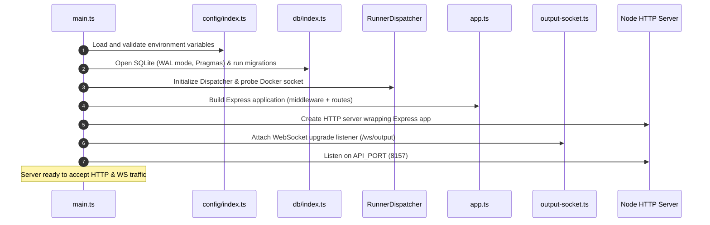
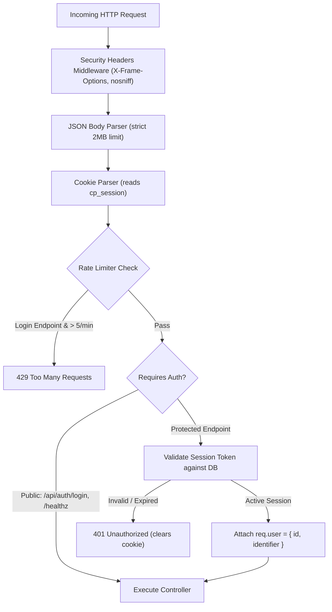
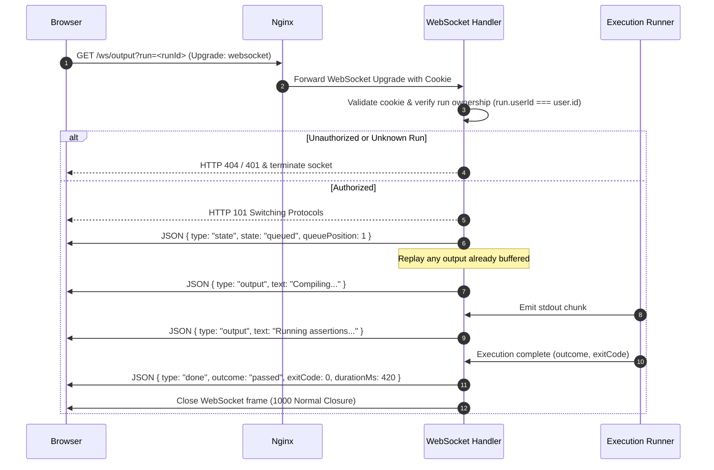

# 03 — Backend & API Architecture Design

This document details the Node.js/Express backend architecture, middleware pipelines, REST API route handlers, WebSocket terminal streaming protocol, and structured logging.

---

## 1. Application Lifecycle & Boot Sequence

The backend executes as a single process (`server/src/main.ts`) responsible for API routing, SQLite transaction management, WebSocket connection handling, and execution container orchestration:



### 1.1 Graceful Shutdown Protocol
When receiving `SIGTERM` or `SIGINT` (from systemd or manual stop):
1. Stop accepting new HTTP requests and reject new `/api/:lang/run` submissions with `503 Service Shutting Down`.
2. Terminate any active ephemeral runner containers and clear the in-memory queue.
3. Broadcast close frames to active WebSocket clients and close connections.
4. Close the SQLite database connection safely (`db.close()`).
5. Terminate the Node.js process cleanly with exit code `0`.

---

## 2. Middleware Pipeline



### 2.1 Session Authorization Middleware
```typescript
import type { Request, Response, NextFunction } from 'express';
import { repositories } from '../repositories/index.js';
import { config } from '../config/index.js';

export function requireAuth(req: Request, res: Response, next: NextFunction): void {
  const sessionId = req.cookies[config.auth.cookieName];
  if (!sessionId) {
    res.status(401).json({ error: 'unauthorized', message: 'Sign in required' });
    return;
  }

  const session = repositories.sessions.resolve(sessionId);
  if (!session) {
    res.clearCookie(config.auth.cookieName);
    res.status(401).json({ error: 'unauthorized', message: 'Session expired' });
    return;
  }

  // Touch session activity asynchronously
  repositories.sessions.touch(sessionId);
  req.user = { id: session.user_id, identifier: session.identifier };
  next();
}
```

---

## 3. REST API Route Specifications

### 3.1 Authentication (`/api/auth`)
* `POST /api/auth/login`
  * **Payload:** `{ "identifier": "<username>", "password": "<password>" }`
  * **Processing:** Validates username against `isPlainUsername` (rejects `@` and whitespace). Queries upstream Reboot01 API. Upserts user in SQLite. Mints 256-bit random session token and sets `HttpOnly`, `SameSite=Lax`, `Secure` cookie.
  * **Response:** `200 OK` `{ "ok": true, "user": { "id": 1, "username": "alice" } }`
* `GET /api/auth/me`
  * **Response:** Current user metadata, preferences, and session expiration timestamp.
* `POST /api/auth/logout`
  * **Processing:** Revokes session in database and clears client cookie.

### 3.2 Catalogue & Exercise Management (`/api/:lang/exercises`)
* `GET /api/:lang/exercises`
  * **Response:** Structured tree of checkpoints, levels, and exercises for the selected language, merged with the user's progress status (`untouched`, `attempted`, `passed`).
* `GET /api/:lang/exercises/:slug`
  * **Response:** Subject markdown, allowed functions, expected file names, and default starter code.
* `GET /api/:lang/exercises/:slug/progress`
  * **Response:** Returns the user's latest saved code draft, last updated timestamp, and passing snapshots.
* `PUT /api/:lang/exercises/:slug/progress`
  * **Payload:** `{ "files": { "student.go": "..." } }`
  * **Processing:** Debounced auto-save. Updates `progress` table idempotently. Preserves `passed` status if already achieved.
  * **Response:** `200 OK` `{ "ok": true, "updatedAt": "2026-11-03T10:00:00.000Z" }`
* `POST /api/:lang/exercises/:slug/snapshot`
  * **Payload:** `{ "files": { "student.go": "..." } }`
  * **Processing:** Stores a named manual snapshot of current code files into the `snapshots` table with `kind = 'manual'`.
  * **Response:** `201 Created` `{ "id": 14, "kind": "manual", "createdAt": "..." }`
* `GET /api/:lang/exercises/:slug/snapshots`
  * **Response:** Array of snapshots (both `passing` and `manual`) for this exercise ordered by `created_at DESC`.

### 3.3 Execution Dispatch (`/api/:lang/run` & `/api/:lang/submit`)
* `POST /api/:lang/run` & `POST /api/:lang/submit`
  * **Payload:** `{ "slug": "<slug>", "files": { "main.go": "..." }, "args": ["custom", "input"] }`
  * **Cooldown Check:** Returns `429 Too Many Requests` `{ "secondsRemaining": 4 }` if triggered within the cooldown window (30 s for run, 90 s for submit, from the end of the previous run — D15).
  * **Queueing:** Enqueues request in `RunnerDispatcher`. Returns immediate `202 Accepted` response with `{ "runId": "<uuid>", "queuePosition": 0 }`.

### 3.4 History, Solutions & Dashboard
* `GET /api/dashboard`
  * **Response:** Completion percentages and counts across Go, JS, and Rust, recent attempts feed (last 10), and pre-test gate warning stats (`gofumpt` / `rc` warnings).
* `GET /api/history?lang=&mode=&outcome=&page=1&limit=20`
  * **Query Params:** Optional filters by `lang` (`go|js|rust`), `mode` (`run|submit`), `outcome` (11 enum values), `page` (default 1), `limit` (default 20, max 100).
  * **Response:** `{ "attempts": [...], "pagination": { "page": 1, "limit": 20, "total": 142, "totalPages": 8 } }`
* `GET /api/history/:id`
  * **Processing:** Validates that the requested attempt belongs to the authenticated student (or returns 404).
  * **Response:** Attempt metadata, code files snapshot at time of execution, exit code, duration in ms, and terminal output log.
* `GET /api/solutions`
  * **Response:** Catalogue of all passed exercises for the authenticated student across all languages, including the passing snapshot timestamp and preview.
* `GET /api/solutions/export`
  * **Response:** Streams an in-memory ZIP archive (`checkpoints-solutions.zip`) containing all passing code files organized into directory trees: `go/<slug>/`, `js/<slug>/`, `rust/<slug>/`.

### 3.5 Mock Exam Simulation (`/api/mock`)
* `POST /api/mock/start`
  * **Payload:** `{ "language": "go", "checkpoint": "checkpoint-01", "durationMins": 180 }`
  * **Processing:** Validates requested checkpoint exists. Creates a new record in `mock_sessions` with `status = 'active'`. Sets default duration to 180 minutes (3 hours) if omitted, or accepts custom duration configured by student. Randomly draws **strictly one exercise per level** for that checkpoint. Stashes active practice drafts to present pristine starter code.
  * **Response:** `201 Created` `{ "sessionId": "<uuid>", "durationMins": 180, "startedAt": "...", "endsAt": "...", "currentLevel": 0, "currentExercise": { "slug": "printnbr", "title": "printnbr", "subject": "..." } }`
* `POST /api/mock/:id/submit`
  * **Payload:** `{ "files": { "student.go": "..." } }`
  * **Processing:** Grades submission against test suite. If pass: updates `highest_level` and `score`, automatically advances to the drawn exercise for the next level. If fail: records attempt within mock log and increments failure count for that level.
  * **Response:** `200 OK` `{ "passed": true, "score": 100, "nextExercise": { ... } | null, "isFinished": false }`
* `POST /api/mock/:id/finish`
  * **Payload:** `{ "reason": "user_completed" | "time_expired" | "abandoned" }`
  * **Processing:** Finalizes session status to `completed` or `abandoned`, sets `ended_at = datetime('now')`, un-stashes user's regular practice drafts.
  * **Response:** `200 OK` Detailed exam performance report `{ "sessionId": "<uuid>", "language": "go", "score": 85, "levelsCompleted": 4, "totalLevels": 5, "durationSeconds": 6420, "timeline": [...] }`

### 3.6 User Account & Preferences (`/api/user`)
* `GET /api/user/preferences`
  * **Response:** `{ "theme": "cp-dark", "keybindings": "standard", "fontSize": 14, "tabSize": 4, "wordWrap": false, "autoFormatOnSave": true }`
* `PUT /api/user/preferences`
  * **Payload:** Partial or full preferences object.
  * **Processing:** Merges with existing `users.preferences_json` in SQLite.
  * **Response:** `200 OK` `{ "ok": true, "preferences": { ... } }`
* `POST /api/user/starred/:slug`
  * **Processing:** Toggles the presence of `slug` in `users.starred_slugs_json`.
  * **Response:** `200 OK` `{ "starred": true, "starredSlugs": ["fprime", "rostring"] }`

---

## 4. WebSocket Terminal Streaming Protocol (`/ws/output`)

Real-time output from execution containers is piped over a dedicated WebSocket connection:



### 4.1 Message Types
* `state`: `{ "type": "state", "state": "queued" | "running" | "done", "queuePosition": number }`
* `output`: `{ "type": "output", "text": string }`
* `done`: `{ "type": "done", "outcome": Outcome, "exitCode": number, "durationMs": number }`

---

## 5. Structured Logging & Observability

The backend uses `pino` for fast, JSON-structured logging:
* **Log Rotation:** Written to `var/logs/backend.log` with daily rotation.
* **Privacy & Redaction:** Sensitive values (`password`, session tokens, user credentials) are automatically redacted using Pino's path masking.
* **Log Levels:** `debug` during local development; `info` in production.

