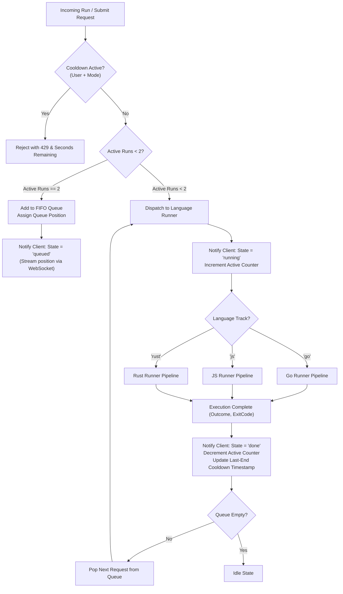

# 04 — Execution Engine & Runners Design

This document details the central runner dispatcher, concurrency queues, language-specific grading pipelines (Go, JavaScript, Rust), container sandboxing security, and the dual Docker/Cloud Run backend architecture.

---

## 1. Central Runner Dispatcher & Queue Architecture

The `RunnerDispatcher` is a singleton service that coordinates all sandbox execution across languages, protecting the host VM (1.9 GB RAM limit) from resource thrashing.



### 1.1 Concurrency & Cooldown Guard
* **Global Concurrency Ceiling:** Maximum **2 concurrent containers**. Attempts exceeding this enter the FIFO queue.
* **Independent Cooldowns:** Cooldowns are tracked per user and per action kind (`<userId>:<mode>`):
  * **Submit Cooldown:** 90 seconds (D15).
  * **Run Cooldown:** 30 seconds (D15).
  * *Design Note:* Run and Submit operate on separate clocks so an active Run cooldown never blocks a student from submitting.

---

## 2. Common Runner Interface (`LanguageRunner`)

```typescript
export type Language = 'go' | 'js' | 'rust';
export type RunMode = 'run' | 'submit';

export type RunRequest = {
  runId: string;
  userId: number;
  language: Language;
  exerciseSlug: string;
  mode: RunMode;
  files: Record<string, string>;
  args?: string[];
};

export type Outcome =
  | 'passed'
  | 'failed'
  | 'unformatted'
  | 'forbidden'
  | 'build_error'
  | 'missing_file'
  | 'timeout'
  | 'output_limit'
  | 'oom'
  | 'cancelled'
  | 'error';

export type RunResult = {
  outcome: Outcome;
  exitCode: number;
  durationMs: number;
  output: string;
};

export interface LanguageRunner {
  readonly language: Language;
  /** Ensures required Docker images or tools exist before accepting traffic */
  probe(): Promise<void>;
  /** Executes the submission and streams stdout/stderr chunks in real-time */
  execute(req: RunRequest, onOutput: (chunk: string) => void): Promise<RunResult>;
  /** Kills an active container when a student cancels or disconnects */
  cancel(runId: string): Promise<void>;
}
```

---

## 3. Language-Specific Execution Pipelines

### 3.1 Go Execution Pipeline (`GoRunner`)
* **Base Image:** `ghcr.io/01-edu/module-go` (compiled with pinned Go toolchain `go1.25.12`).
* **Two-Module Workspace:**
  * Staged on host in an ephemeral temp directory:
    * `piscine-go/` $\rightarrow$ Student submission code with `go.mod` (module `student`).
    * `test-go/` $\rightarrow$ Canonical 01-edu test harness with `go.mod` configured: `replace student => ../piscine-go`.
* **Execution Gates:**
  1. **Gate 1 (`gofumpt`):** Runs `gofumpt -l -w .`. If any file is modified or listed, terminates with **Exit 10 (`unformatted`)**.
  2. **Gate 2 (`rc`):** Runs the AST analyzer tool `rc`. If disallowed standard library functions are imported or called, terminates with **Exit 11 (`forbidden`)**.
  3. **Gate 3 (`go test`):** Executes `go test -v ./...`. Correct output yields **Exit 0 (`passed`)**; assertion failure yields **Exit 1 (`failed`)**; compiler failure yields **Exit 12 (`build_error`)**.

### 3.2 JavaScript Execution Pipeline (`JsRunner`)
* **Base Image:** Node.js LTS minimal container.
* **Isolation:** Submissions are written into an isolated runtime directory.
* **Test Harness:** Mounts the canonical 01-edu test harness from `content/js/exercises/<slug>/test.js` as read-only.
* **Execution:** Executes `node test.js` under a strict memory cap (256 MB) and timeout (30 seconds).

### 3.3 Rust Execution Pipeline (`RustRunner`)
* **Base Image:** Custom runner image with pre-cached crates (e.g. `rand`, `regex`, `chrono`) to ensure fast incremental builds.
* **Hidden Test Injection:**
  * Student code is placed into `src/lib.rs` / `src/main.rs`.
  * The hidden `tests/` suite containing differential test assertions is mounted read-only.
* **Differential Testing:** Test harness compares the student function's output directly against pre-compiled reference solution binaries.
* **OOM Detection:** On container exit, the runner explicitly queries Docker inspect flags (`state.OOMKilled === true`) to report an unambiguous `oom` verdict instead of a confusing compiler panic.

---

## 4. Container Sandboxing Security

Every local container execution enforces strict Linux kernel isolation flags via `dockerode`:

```typescript
const containerOptions: Docker.ContainerCreateOptions = {
  Image: runnerImage,
  Cmd: executionCommand,
  AttachStdout: true,
  AttachStderr: true,
  Tty: false,
  HostConfig: {
    AutoRemove: true,                   // Equivalent to --rm
    NetworkMode: 'none',                // Zero outbound network access
    Memory: 256 * 1024 * 1024,          // 256 MB RAM limit
    MemorySwap: 256 * 1024 * 1024,      // Swap disabled
    NanoCpus: 1000000000,               // 1.0 vCPU limit
    CapDrop: ['ALL'],                   // Drop all Linux capabilities
    SecurityOpt: ['no-new-privileges'], // Prevent setuid privilege escalation
    ReadonlyRootfs: false,              // Ephemeral tmpfs mounts for compilation
    Binds: [
      `${stagedDir}:/app:rw`,
      `${canonicalTestDir}:/tests:ro`, // Tests mounted strictly read-only
    ],
  },
};
```

---

## 5. Dual-Backend Strategy: Docker vs. Cloud Run

The architecture decouples the execution transport from the backend logic via the `RUNNER_BACKEND` environment variable:

```
RUNNER_BACKEND=docker    # Runs locally via Docker socket on appsyss-vm
RUNNER_BACKEND=cloudrun  # Dispatches grading to Google Cloud Run
```

### 5.1 Cloud Run Driver Details
When `RUNNER_BACKEND=cloudrun` is enabled:
* The backend bundles the student's submission files into a lightweight JSON payload.
* Posts over HTTPS to the private Cloud Run grading service with a shared bearer secret.
* Cloud Run executes the identical container image in an isolated serverless microVM and streams output back via HTTP chunked transfer.
* Completely offloads CPU and memory pressure from `appsyss-vm`, reducing median grading latency from ~3500ms to ~550ms.

