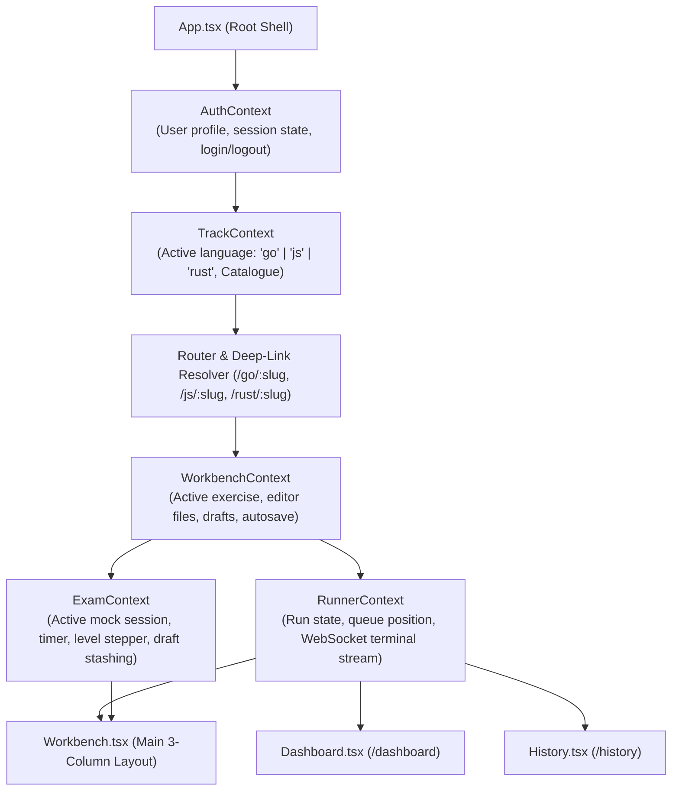
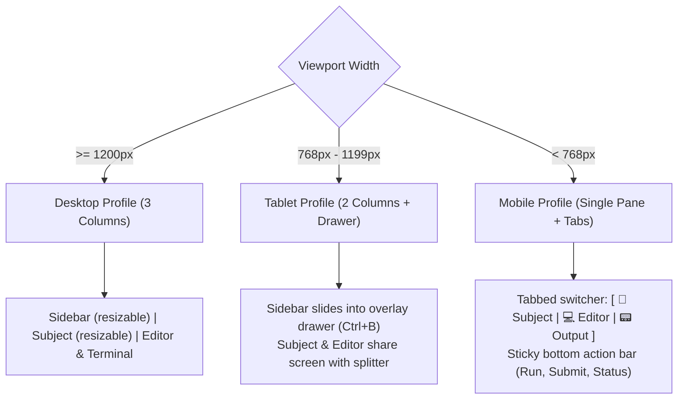

# 05 — Frontend Architecture & Components Design

This document details the React 18 / Vite single-page application (SPA), the context state architecture, component hierarchy, responsive multi-breakpoint layout, Monaco editor integration, and mobile ergonomics.

---

## 1. Application Architecture & Context State Graph

The frontend is built with React 18 and bundled with Vite. Application state is partitioned into focused, composable React Context providers to prevent unnecessary re-renders:



### 1.1 Context State Responsibilities
* **`AuthContext`:** Manages user login state, session cookies, and profile preferences (`theme`, `keybindings`, `starred`).
* **`TrackContext`:** Holds the active language track (`Go`, `JavaScript`, `Rust`). Handles track switching and fetches that language's checkpoint catalogue.
* **`WorkbenchContext`:** Owns open file tabs, active editor code, and debounced 900ms autosave to the backend.
* **`RunnerContext`:** Manages run execution lifecycle (`idle` $\rightarrow$ `queued` $\rightarrow$ `running` $\rightarrow$ `done`), WebSocket lifecycle (`/ws/output?run=<id>`), and outcome diagnosis.
* **`ExamContext`:** Manages mock checkpoint exams, isolates practice drafts by substituting pristine starter stubs, drives the 3-hour countdown timer, and records exam logs.

---

## 2. Component Hierarchy & Layout Structure

```
<App>
  ├── <HeaderBar>
  │     ├── <Logo>
  │     ├── <TrackPicker>            # [ Go | JavaScript | Rust ]
  │     ├── <BreadcrumbNav>          # Checkpoint 02 > Level 01 > strlen
  │     ├── <ExamHUD>                # Timer countdown & level stepper (during exams)
  │     └── <UserNav>                # Dashboard, History, Preferences, About, Sign Out
  └── <MainViewport>
        ├── <ExerciseSidebar>        # Left column
        │     ├── <ProgressBar>      # e.g., 45/60 Passed
        │     ├── <CompactRailToggle># Collapse to ~48px dot rail
        │     ├── <ExerciseTree>     # Checkpoint -> Level -> Exercise rows
        │     │     └── <ExerciseDot># Compact dot indicators with name tooltip
        │     └── <ExamModeButton>   # Pinned bottom exam launcher
        ├── <Splitter axis="x" />
        ├── <SubjectPane>            # Centre column
        │     ├── <SubjectMarkdown>  # Instructions, examples, signatures
        │     ├── <AllowedFunctions> # Go-specific permitted API panel
        │     └── <HintButton>       # 💡 Hint (10-second friction modal)
        ├── <Splitter axis="x" />
        └── <WorkbenchPane>          # Right column
              ├── <FileTabBar>       # student.go, main.go tabs + Mobile Undo/Redo
              ├── <MonacoEditor>     # Main code editor instance
              ├── <ArgsInputRow>     # Optional command-line arguments row
              ├── <RunToolbar>       # Run, Submit, Cancel, Cooldown countdown
              ├── <AssertionDiffCard># Visual diff shown on assertion failure
              ├── <Splitter axis="y" />
              └── <TerminalPane>     # xterm.js (desktop) / PlainTerminal (mobile)
```

---

## 3. Responsive Multi-Breakpoint System

The workbench dynamically adapts across three distinct viewport profiles:



### 3.1 Mobile-Specific Components
1. **`PlainTerminal.tsx`:** Dynamically replaces `xterm.js` on mobile screens (`< 768px`). Parses ANSI color codes into pure HTML `<span>` tags with automatic line-wrapping. Eliminates software keyboard focus issues and enables native long-press text selection.
2. **`CodeKeyboardBar.tsx`:** Floating mobile symbol toolbar positioned above the on-screen keyboard, offering one-tap access to `( ) { } [ ] ; : . , = & ! " _ -> ::` and cursor arrows.
3. **Mobile Undo/Redo:** Fixed ↶ Undo and ↷ Redo buttons in the editor tab bar to compensate for the lack of `Ctrl+Z` / `Ctrl+Y` on mobile touchscreens.

---

## 4. Monaco Editor Integration

Monaco is embedded via `@monaco-editor/react` with customized syntax tokenizers and configuration:

```typescript
const editorOptions: monaco.editor.IStandaloneEditorConstructionOptions = {
  fontSize: userPreferences.fontSize || 13,
  fontFamily: 'ui-monospace, "JetBrains Mono", Menlo, Consolas, monospace',
  tabSize: activeLanguage === 'go' ? 4 : 2,
  insertSpaces: activeLanguage !== 'go', // Go enforces hard tabs per gofmt
  minimap: { enabled: false },
  scrollBeyondLastLine: false,
  automaticLayout: true,
  renderWhitespace: 'selection',
  wordWrap: userPreferences.wordWrap ? 'on' : 'off',
  theme: userPreferences.theme || 'cp-dark',
};
```

---

## 5. Pedagogical Hint System (`HintPopup.tsx`)

The hint system introduces deliberate friction to foster genuine learning:

```typescript
// HintPopup.tsx - 10-Second friction countdown
export function HintPopup({ open, slug, onClose }: { open: boolean; slug: string; onClose: () => void }) {
  const [countdown, setCountdown] = useState(10);
  const [pepTalk] = useState(() => pickRandom(PEP_TALKS)); // e.g. "Struggling means you are learning"

  useEffect(() => {
    if (!open) return;
    setCountdown(10);
    const timer = setInterval(() => setCountdown((c) => Math.max(0, c - 1)), 1000);
    return () => clearInterval(timer);
  }, [open]);

  return (
    <Modal open={open} onClose={onClose} title="💡 Exercise Hint">
      {countdown > 0 ? (
        <div className="countdown-view">
          <CountdownRing seconds={countdown} total={10} />
          <p className="pep-talk">{pepTalk}</p>
          <button className="btn-cancel" onClick={onClose}>Cancel — I'll try myself</button>
        </div>
      ) : (
        <div className="hint-steps">
          <StepList steps={getHintsForSlug(slug)} />
          <button className="btn-done" onClick={onClose}>Got it</button>
        </div>
      )}
    </Modal>
  );
}
```

---

## 6. Design Tokens & Styling (`styles.css`)

The interface uses standard CSS custom properties ensuring WCAG AA contrast (minimum 4.5:1 ratio):

```css
:root {
  /* Surfaces */
  --bg: #07080b;
  --surface: #0b0d12;
  --raised: #101318;
  --hover: #161a21;
  --code-bg: #05060a;

  /* Borders */
  --border: #1e232c;
  --border-strong: #2a313d;

  /* Typography */
  --text: #dbe3ef;
  --text-muted: #94a3b8;
  --text-dim: #77839c;

  /* Accents & Status */
  --accent: #2f6feb;
  --accent-text: #6ba4ff;
  --success: #3ddc97;
  --danger: #f0736a;
  --warning: #e0a33a;

  --radius: 6px;
  --shadow: 0 10px 28px rgba(0, 0, 0, 0.55);
}
```

---

## 7. Mock Exam Simulation Flow & Components (`ExamModal.tsx`, `ExamHUD.tsx`)

The mock exam simulation accurately emulates official Reboot01 exam conditions:

### 7.1 Exam Configuration & Start Modal (`ExamModal.tsx`)
* **Trigger:** Click "Mock Exam" button at the bottom of the exercise sidebar.
* **Selection Form:**
  * **Checkpoint Selector:** Dropdown of available checkpoints for the active language track (e.g. `Checkpoint 01`, `Checkpoint 02`).
  * **Duration Setting:** Number input preset to **180 minutes (3 hours)** by default, user-configurable between 30 and 360 minutes.
  * **Level Curriculum Preview:** Displays the levels that will be tested (e.g. Levels 0 through 4).
* **Strict Rule Enforcement:** Exactly **one exercise per level** is randomly sampled by the backend. The student cannot pick or skip questions.
* **Practice Draft Isolation:**
  * On exam launch, `ExamContext` stashes the student's existing drafts in local storage.
  * The workbench loads fresh, pristine starter stubs for the drawn exercises, preventing students from relying on pre-written practice code.
  * When the exam ends, the student's previous practice drafts are restored intact.

### 7.2 Active Exam Heads-Up Display (`ExamHUD.tsx`)
* When an exam session is active, the global header replaces navigation with the `<ExamHUD>`:
  * **Countdown Timer:** Live countdown clock displaying remaining time (`HH:MM:SS`), with warning colors (amber under 30 mins, pulsing red under 10 mins).
  * **Level Stepper:** Visual pill indicator showing completed levels, active level, and upcoming levels:
    `[✓ L0] [✓ L1] [▶ L2 (Current)] [○ L3] [○ L4]`
  * **Finish / Abandon Button:** Allows graceful exit at any time with an early submission confirmation dialog.

---

## 8. About & Community Acknowledgements Modal (`AboutModal.tsx`)

Accessible from the global navigation bar and footer overflow menu, the `<AboutModal>` presents system information and transparent community credits:

### 8.1 Modal Content & Structure
1. **Platform Purpose:**
   * Independent, free, browser-based practice platform designed to support students preparing for Reboot01 coding checkpoints across Go, JavaScript, and Rust.
2. **Non-Affiliation Notice:**
   * Explicit disclaimer that `checkpoints` is an independent student-led community project and is not affiliated with, endorsed by, or sponsored by Reboot or 01-edu.
3. **Core Author & Lead Developer:**
   * Built and maintained by **Abbas Hasan** (`@abbhasan`).
4. **Community Acknowledgements & Special Thanks:**
   * Prominently highlights and thanks **Ali Alsaroo** (`aalsaroo`) for his valuable design ideas and contributions to the student experience:
     * Mobile touch ergonomics: sticky programming symbol row (`CodeKeyboardBar.tsx`), mobile text selection layer, and the ANSI plain-text terminal adaptation (`PlainTerminal.tsx`).
     * Pedagogical hint system: the 10-second intentional friction countdown modal.
     * Mock exam simulation workflows and testing.


