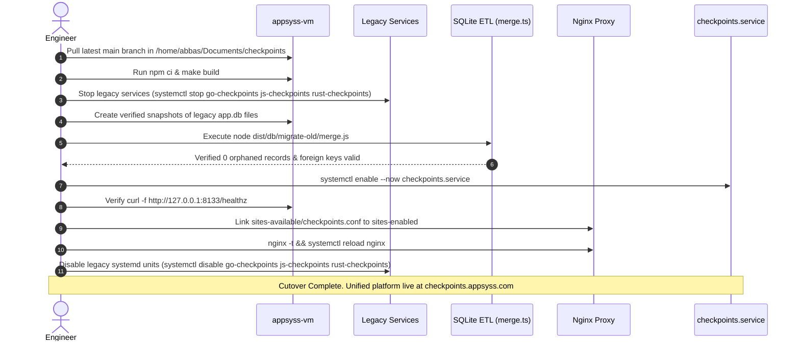

# 06 — Deployment & Operations Design

This document specifies the production infrastructure, port allocations, Nginx reverse proxy configuration, systemd service unit, automated database backups, and the zero-downtime production cutover runbook.

---

## 1. Hosting Environment & Resource Limits

* **Production Host:** `appsyss-vm` (`136.114.230.206`, Debian Linux).
* **System Resource Budget:** **~1.9 GB total RAM**, shared with multiple active host services.
* **Process Target:** Single Node.js backend daemon (<70 MB idle, <180 MB peak RSS) replacing three separate Node daemons previously running for Go, JS, and Rust.

### 1.1 Port Allocation
* **`API_PORT = 8133`:** Binds to `127.0.0.1:8133` on the host, serving the Express API and `/ws/output` WebSocket upgrades behind Nginx.
* **`WEB_PORT = 5192`:** Reserved for local development Vite server. In production, Nginx serves the pre-built `web/dist` SPA directly from disk.
* *Note on Port 8135:* Port 8135 is reserved for `chess` in `/home/abbas/Documents/0.My_Strategy/ports_used.md`. Consolidating onto **8133** reclaims the `go-checkpoints` allocation and cleanly retires ports 8128, 8130, and 8133.

---

## 2. Nginx Reverse Proxy & Redirection Architecture

Nginx terminates TLS at `443`, handles HTTP-to-HTTPS redirection, routes legacy subdomains permanently (HTTP 301) to the unified platform, proxies API/WebSocket traffic to Node, and serves the static SPA:

```nginx
# /etc/nginx/sites-available/checkpoints.conf

# 1. Permanent Redirects from Legacy Subdomains (Preserve Existing Bookmarks)
server {
  listen 80;
  listen 443 ssl http2;
  server_name go-checkpoints.appsyss.com;
  ssl_certificate     /etc/letsencrypt/live/go-checkpoints.appsyss.com/fullchain.pem;
  ssl_certificate_key /etc/letsencrypt/live/go-checkpoints.appsyss.com/privkey.pem;
  return 301 https://checkpoints.appsyss.com/go$request_uri;
}

server {
  listen 80;
  listen 443 ssl http2;
  server_name js-checkpoints.appsyss.com;
  ssl_certificate     /etc/letsencrypt/live/js-checkpoints.appsyss.com/fullchain.pem;
  ssl_certificate_key /etc/letsencrypt/live/js-checkpoints.appsyss.com/privkey.pem;
  return 301 https://checkpoints.appsyss.com/js$request_uri;
}

server {
  listen 80;
  listen 443 ssl http2;
  server_name rust-checkpoints.appsyss.com;
  ssl_certificate     /etc/letsencrypt/live/rust-checkpoints.appsyss.com/fullchain.pem;
  ssl_certificate_key /etc/letsencrypt/live/rust-checkpoints.appsyss.com/privkey.pem;
  return 301 https://checkpoints.appsyss.com/rust$request_uri;
}

# 2. Main HTTP to HTTPS Redirection
server {
  listen 80;
  listen [::]:80;
  server_name checkpoints.appsyss.com;
  location /.well-known/acme-challenge/ { root /var/www/html; }
  location / { return 301 https://$host$request_uri; }
}

# 3. Main Unified Application Server
server {
  listen 443 ssl http2;
  listen [::]:443 ssl http2;
  server_name checkpoints.appsyss.com;

  ssl_certificate     /etc/letsencrypt/live/checkpoints.appsyss.com/fullchain.pem;
  ssl_certificate_key /etc/letsencrypt/live/checkpoints.appsyss.com/privkey.pem;
  include /etc/letsencrypt/options-ssl-nginx.conf;
  ssl_dhparam /etc/letsencrypt/ssl-dhparams.pem;

  # Security Headers
  add_header X-Frame-Options SAMEORIGIN always;
  add_header X-Content-Type-Options nosniff always;
  add_header Referrer-Policy strict-origin-when-cross-origin always;
  add_header Strict-Transport-Security "max-age=31536000; includeSubDomains" always;

  client_max_body_size 2m;

  # Real-Time WebSocket Output Stream
  location /ws/ {
    proxy_pass http://127.0.0.1:8133;
    proxy_http_version 1.1;
    proxy_set_header Upgrade    $http_upgrade;
    proxy_set_header Connection "upgrade";
    proxy_set_header Host       $host;
    proxy_set_header X-Forwarded-For $proxy_add_x_forwarded_for;
    proxy_read_timeout 300s;
    proxy_send_timeout 300s;
  }

  # REST API Endpoints
  location /api/ {
    proxy_pass http://127.0.0.1:8133;
    proxy_http_version 1.1;
    proxy_set_header Host $host;
    proxy_set_header X-Forwarded-For $proxy_add_x_forwarded_for;
    proxy_set_header X-Forwarded-Proto $scheme;
    proxy_read_timeout 180s;
  }

  # Health Check Endpoint
  location = /healthz {
    proxy_pass http://127.0.0.1:8133;
    proxy_set_header Host $host;
  }

  # Single Page Application Static Build
  location / {
    root /home/abbas/Documents/checkpoints/web/dist;
    try_files $uri $uri/ /index.html;
  }
}
```

---

## 3. Systemd Service Unit (`checkpoints.service`)

The backend is managed as a standard systemd service with hard memory ceiling enforcement to protect the 1.9 GB host RAM:

```ini
# /etc/systemd/system/checkpoints.service
[Unit]
Description=Unified Reboot01 Checkpoint Platform
After=network.target docker.service
Requires=docker.service

[Service]
Type=simple
User=abbas
Group=abbas
WorkingDirectory=/home/abbas/Documents/checkpoints/server
EnvironmentFile=/home/abbas/Documents/checkpoints/.env.vm
ExecStart=/usr/bin/node dist/main.js
Restart=always
RestartSec=5

# Host RAM Protection Quotas
MemoryHigh=256M
MemoryMax=384M

# Logging
StandardOutput=journal
StandardError=journal
SyslogIdentifier=checkpoints

[Install]
WantedBy=multi-user.target
```

---

## 4. Automated Database Backups

A cron job runs daily at 03:00 UTC to produce safe online SQLite snapshots using SQLite's online backup API (via the `.backup` shell command):

```bash
#!/usr/bin/env bash
# scripts/backup-db.sh
set -euo pipefail

BACKUP_DIR="/home/abbas/Documents/backups/checkpoints"
DB_PATH="/home/abbas/Documents/checkpoints/var/db/app.db"
TIMESTAMP=$(date +"%Y%m%d_%H%M%S")

mkdir -p "$BACKUP_DIR"
sqlite3 "$DB_PATH" ".backup '${BACKUP_DIR}/app_${TIMESTAMP}.db'"
gzip -9 "${BACKUP_DIR}/app_${TIMESTAMP}.db"

# Retain backups for 14 days
find "$BACKUP_DIR" -type f -name "app_*.db.gz" -mtime +14 -delete
```

---

## 5. Production Cutover Runbook

Executing the migration and cutover follows a strict sequential runbook:



