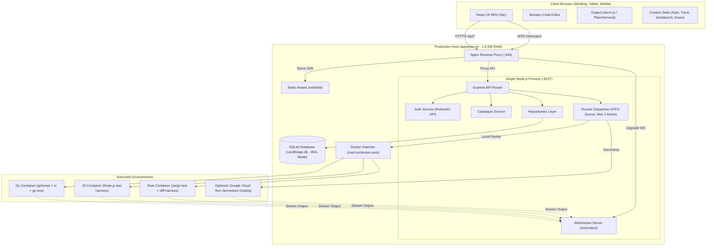

# 01 Design — System Architecture & Implementation Specifications

This directory contains the detailed engineering design specifications for the unified **Reboot01 Checkpoint Platform** (`checkpoints`), consolidating `go-checkpoints`, `js-checkpoints`, and `rust-checkpoints` into a single, high-performance, multi-language application.

---

## 1. System Vision & Core Design Principles

1. **Unified Platform, Isolated Sandboxes:**
   A single student account, single login session, and single frontend workbench for Go, JavaScript, and Rust, while execution sandboxes remain strictly isolated, secure, and faithful to official 01-edu grading semantics.
2. **Zero Resource Regression on Host VM:**
   The host machine (`appsyss-vm`) operates under a strict **1.9 GB total RAM limit**. The unified architecture consolidates three separate Node.js server daemons and SQLite pools into **exactly one Node backend process** (<70 MB idle RSS, <180 MB peak RSS) and one static SPA build.
3. **100% Deterministic Grading Parity:**
   Verdicts are identical to official Reboot01 platform evaluations:
   * **Go:** Format enforcement (`gofumpt`), restricted AST calls (`rc`), and two-module testing.
   * **JavaScript:** Ephemeral isolated Node sandbox with 01-edu verification harness.
   * **Rust:** Pre-compiled cargo dependencies, hidden `_test` crate injection, and differential output assertions.
4. **Resilient Production Data Migration:**
   A lossless, verified ETL migration combines historical user profiles, progress, code drafts, snapshots, and attempt logs from the three active production databases into the unified schema without data loss or downtime.

---

## 2. Design Specification Suite

The design is organized into modular engineering documents:

| Document | Title | Description |
|---|---|---|
| [**01_monorepo_and_scaffolding.md**](01_monorepo_and_scaffolding.md) | Monorepo & Scaffolding | Workspace structure, root Makefile, configuration hierarchy (`.env`, `.env.vm`), build scripts, and shared type definitions. |
| [**02_database_and_migration_design.md**](02_database_and_migration_design.md) | Database & Migration Design | SQLite WAL configuration, schema DDL, repository layer, and the multi-database merge script (`merge.ts`). |
| [**03_backend_and_api_design.md**](03_backend_and_api_design.md) | Backend & API Architecture | Express server lifecycle, middleware pipelines (auth, rate limits), REST API routes, WebSocket streaming protocol, and structured logging. |
| [**04_execution_engine_and_runners.md**](04_execution_engine_and_runners.md) | Execution Engine & Runners | `RunnerDispatcher` FIFO queue, concurrency ceilings, language-specific grading pipelines (Go, JS, Rust), and Docker vs. Cloud Run backends. |
| [**05_frontend_architecture_and_components.md**](05_frontend_architecture_and_components.md) | Frontend Architecture & Components | React 18 + Vite SPA, context state graph, component hierarchy, responsive multi-breakpoint layout, Monaco integration, and mobile touch ergonomics. |
| [**06_deployment_and_operations.md**](06_deployment_and_operations.md) | Deployment & Operations | Host ports (`API_PORT=8157`), Nginx reverse proxy, SSL, legacy subdomain 301 redirects, systemd service unit, and production cutover runbook. |

---

## 3. High-Level Architecture Diagram

